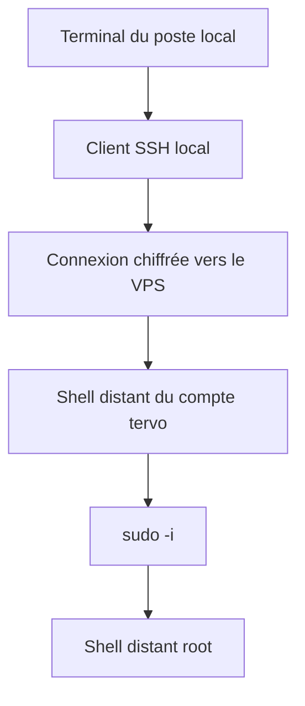

# Cours 01 — Du poste local au VPS : Linux, SSH, sudo et shell

[Parcours complet](README.md) · [Chapitre suivant](02-images-conteneurs-compose.md)

## Objectif

Comprendre **où une commande s'exécute, avec quelle identité, sur quels
fichiers et avec quelles permissions**. Ce sont les premières questions à
poser avant de déployer. Une commande correcte sur la mauvaise machine peut
être plus dangereuse qu'une commande qui échoue.

Les exemples de ce cours sont à adapter et ne sont pas exécutés pour écrire
la documentation. Les résultats réellement obtenus sont dans le
[journal d'accès](../../notes/backend/sprint7.6/INT-129/journal/01-acces-et-preparation.md).

## 1. Un terminal n'est pas une machine

Le terminal est une fenêtre d'entrée/sortie. Le **shell** est le programme
qui interprète ce que tu saisis. Avec SSH, cette même fenêtre affiche
ensuite un shell qui tourne sur une autre machine.



Le chemin `$HOME/.ssh/tervo_ed25519` appartient au **poste local** quand tu
charges la clé. Après `sudo -i` sur le VPS, `$HOME` désigne normalement
`/root` **sur le VPS**. Ce n'est plus le même dossier.

### Commandes de repérage — lecture seule

À exécuter dans le terminal dont on veut connaître le contexte :

```sh
hostname
id
pwd
printf '%s\n' "$HOME"
```

| Commande | Question à laquelle elle répond | Succès attendu | En cas de surprise |
|---|---|---|---|
| `hostname` | Quelle machine ? | Un nom, code 0 | Ne pas poursuivre une mutation avant d'identifier l'hôte |
| `id` | Quel utilisateur, quels groupes ? | UID/GID/groupes, code 0 | Ne pas déduire les droits du seul nom affiché dans le prompt |
| `pwd` | Quel répertoire courant ? | Chemin absolu, code 0 | Utiliser un chemin explicite ou `git -C` |
| `printf … "$HOME"` | Quel dossier personnel ? | Chemin, code 0 | Distinguer le HOME local du HOME distant |

Dans la recette, `hostname` a indiqué `22565`. `id` a d'abord indiqué
`tervo`, UID 1000 ; `id -u` a ensuite indiqué `0` dans le terminal root de
l'opérateur. Ce changement d'identité a été vérifié, pas supposé.

## 2. SSH : deux identités différentes à vérifier

SSH répond à deux questions :

1. **Le serveur est-il celui attendu ?** Le client vérifie sa clé d'hôte
   à l'aide de `known_hosts`.
2. **Le client peut-il se connecter comme cet utilisateur ?** Le serveur
   vérifie notamment la preuve de possession de la clé privée autorisée.

La clé privée reste sur ton poste. La passphrase protège cette clé au repos.
Elle n'est ni le mot de passe Linux distant, ni celui de PostgreSQL.

### Charger la clé puis se connecter — poste local

```sh
ssh-add -t 2h "$HOME/.ssh/tervo_ed25519"
ssh -o StrictHostKeyChecking=yes tervo@151.241.228.152
```

| Élément | But | Retour attendu |
|---|---|---|
| `ssh-add` | Rendre la clé disponible via l'agent SSH | Ajout de l'identité, code 0 |
| `-t 2h` | Limiter sa durée de présence dans l'agent | Durée annoncée de 7200 secondes |
| `tervo@…` | Choisir le compte Linux distant | Prompt du compte après authentification |
| `StrictHostKeyChecking=yes` | Refuser une clé d'hôte inconnue ou non conforme au contexte approuvé | Échec plutôt qu'acceptation aveugle |

Lors d'un premier accès, l'empreinte doit être vérifiée par une source
indépendante. On ne résout pas une alerte d'identité d'hôte en désactivant
sa vérification. La procédure historique est dans
[l'inventaire SSH](../../notes/backend/deploy/vps/01-inventaire-et-acces-ssh.md).

L'expiration de la clé dans l'agent empêche son nouvel usage automatique ;
elle ne ferme pas une session SSH déjà établie. Fermer une fenêtre ou faire
`exit` termine le shell correspondant. Un shell root imbriqué demande
d'abord une sortie vers `tervo`, puis une sortie de SSH.

## 3. Authentification et autorisation ne sont pas synonymes

Une connexion SSH réussie prouve l'identité acceptée pour le compte.
Elle ne prouve pas que ce compte peut administrer Docker ou arrêter Caddy.

Dans le terminal **distant**, les commandes suivantes ont des rôles distincts :

```sh
sudo -n true
sudo -i
id -u
```

| Commande | Sens | Retour attendu |
|---|---|---|
| `sudo -n true` | Tester l'autorisation sans demande interactive | 0 si autorisé ; sinon refus immédiat |
| `sudo -i` | Ouvrir un shell administrateur avec l'environnement de connexion root | Peut demander le mot de passe localement ; ne pas le partager |
| `id -u` | Vérifier l'UID du shell courant | `0` pour root |

**Ce qui s'est passé :** recharger la clé SSH n'a pas supprimé le besoin de
mot de passe sudo. L'agent pouvait lire certaines informations mais pas
interroger le socket Docker. L'opérateur a donc exécuté les blocs root dans
son propre terminal. Aucune règle `NOPASSWD` n'a été ajoutée.

Ne pas mélanger non plus :

| Identité | Autorité |
|---|---|
| Compte Linux `tervo` / root | Fichiers, processus et services du VPS |
| Rôle PostgreSQL `tervo_admin` / `tervo_app` | Base, tables et privilèges SQL |
| Utilisateur administrateur Tervo | Actions métier via l'API |
| Compte de connexion Dockge | Accès à l'interface de console |

Être root ne crée pas un administrateur métier dans Tervo. Une API joignable
ne prouve donc pas qu'un premier utilisateur production a été bootstrapé.

## 4. Permissions : lire 700, 600 et 644

Les permissions Unix distinguent propriétaire, groupe et autres. Chaque
chiffre additionne lecture `4`, écriture `2`, exécution/traversée `1`.

| Mode | Fichier | Dossier |
|---|---|---|
| `600` | Propriétaire : lecture/écriture seulement | Inadapté à un dossier qu'il faut traverser |
| `700` | Propriétaire : lecture/écriture/exécution | Propriétaire seul peut lister et traverser |
| `644` | Propriétaire : lecture/écriture ; autres : lecture | Pas un mode normal pour un dossier traversable |

Sur un dossier, `x` signifie notamment pouvoir le traverser pour atteindre
une entrée connue. Ce n'est pas « lancer le dossier ».

### Exemple de préparation privée — seulement sur un nouveau chemin de recette

```sh
umask 077
install -d -m 700 /chemin/prive/de-recette
chmod 600 /chemin/prive/de-recette/fichier.env
```

Exemple non exécuté tel quel : il faut choisir un chemin autorisé et un
fichier existant. `umask` limite les permissions des **nouvelles créations** ;
il ne corrige pas les anciens fichiers. `chmod` change un fichier précis.
Succès normal : silence et code 0. Contrôle en lecture seule :

```sh
stat -c '%a %U %n' /chemin/prive/de-recette/fichier.env
```

Attendu illustratif : mode `600`, propriétaire opérateur, chemin choisi.
Si le propriétaire ou le chemin n'est pas celui attendu, arrêter la procédure
plutôt que lancer un `chmod -R` sur tout le projet.

Pourquoi ne pas tout mettre en 600 ? Dans une première fixture locale,
les SQL montés dans PostgreSQL étaient devenus illisibles pour l'utilisateur
du serveur DB. La création de `tervo_app` avait échoué. Le fichier secret
doit être privé ; un fichier SQL non secret monté en lecture doit rester
lisible par le processus qui le consomme.

### Ce que l'incident INT-111 ajoute à cette règle

Un `git clone` sous `umask 077` restreint aussi les permissions des nouveaux
fichiers. Git distingue principalement le caractère exécutable d'un fichier ;
un checkout « propre » ne prouve donc pas que ses permissions Unix conviennent
aux processus qui le lisent. Le build Docker effectué par un acteur privilégié
peut réussir alors que PostgreSQL ne peut pas lire un SQL monté.

Dans INT-111, le log a montré `10-app.sql: Permission denied`. La correction
ciblait les deux SQL non secrets en `644`, pas le `.env`. Leurs modes exacts
avant correction n'ont pas été retranscrits : ne pas inventer une capture `stat`.

Pour comprendre le masque, un fichier ordinaire demandé en `666` devient
généralement `600` sous `077`, ou `644` sous `022`. Un dossier demandé en
`777` devient `700` ou `755`. **Le masque retire des droits, il n'en ajoute pas.**
Sur une future préparation neuve : `022` pour les sources non secrètes,
`077` avant de créer les secrets ; le fichier `.env` reste explicitement privé.
La commande `stat` applicable à la stack est dans le
[guide opérateur](../../notes/backend/deploy/vps/05-tervo-release-et-exploitation.md).

## 5. Comprendre les blocs shell utilisés dans la recette

Un petit exemple **pédagogique, sans accès au VPS** :

```sh
(
set -eu
NAME="recette"
printf 'Cible : %s\n' "$NAME"
)
```

Attendu illustratif : `Cible : recette`, code 0.

| Syntaxe | Sens |
|---|---|
| `( … )` | Sous-shell : les affectations ne polluent pas le shell parent |
| `set -e` | Interrompre le bloc sur beaucoup d'erreurs non traitées ; pas une garantie universelle, notamment dans les conditions et pipelines |
| `set -u` | Refuser l'expansion d'une variable non définie |
| `"$VAR"` | Garder la valeur comme un argument, même avec espaces |
| `$(commande)` | Capturer stdout, en retirant les retours à la ligne finaux |
| `>` / `>>` | Écraser / ajouter dans un fichier ; ce sont des écritures |
| `2>&1` | Diriger stderr vers la destination actuelle de stdout |
| `\|` | Relier stdout d'une commande à stdin de la suivante |
| `set -- …` puis `"$@"` | Regrouper puis réutiliser des arguments sans les fusionner |

`set -e` n'est pas un mécanisme de rollback : si une commande a déjà créé
un fichier, l'arrêt du bloc ne le supprime pas. C'est pourquoi on évitait
de relancer aveuglément un bloc interrompu.

Il faut aussi regarder **quel shell** s'arrête. Saisi directement dans le
shell root obtenu par `sudo -i`, `set -e` peut faire sortir de root après
une erreur et afficher le prompt `tervo`. Ce retour ne signifie pas que les
commandes précédentes ont été exécutées sans droits root. Le sous-shell
`( … )` du bloc pédagogique isole l'arrêt sans fermer le shell parent.

Enfin, `ls chemin 2>/dev/null || echo absent` est trompeur : « Permission
denied » et « fichier absent » deviennent le même message. Garder stderr
visible lors d'un diagnostic, puis distinguer absence et droits insuffisants.

Un heredoc cité `<<'SQL'` transmet un texte sans substitutions shell.
Un heredoc non cité `<<EOF` remplace les variables : c'était voulu pour
écrire le `.env` privé. La génération de secrets ne devait jamais être
accompagnée de `set -x`, qui trace les arguments et pourrait les exposer.

## 6. Code de sortie, stdout et stderr

Le code `0` signifie généralement succès ; un autre code signale un échec
ou un résultat particulier défini par l'outil. **Une sortie vide n'est pas
une erreur en soi.** `test`, `chmod` et `config --quiet` peuvent réussir
silencieusement.

Dans un test négatif, on attend au contraire un refus précis :

```sh
# Exemple pédagogique local, sans effet externe.
RC=0
false || RC=$?
test "$RC" -eq 1
printf 'Refus attendu contrôlé, code=%s\n' "$RC"
```

Attendu illustratif : `Refus attendu contrôlé, code=1`, code final 0.
Cela illustre pourquoi le bloc de test peut réussir alors que la commande
testée a correctement échoué. En recette réelle on vérifiait aussi la
**cause** via un message précis, pas uniquement le code.

## 7. À retenir pour l'entretien

**Pourquoi vérifier l'hôte et l'UID avant de déployer ?**

Parce que la cible et les droits font partie de l'opération. Une commande
destructive correcte mais exécutée sur la mauvaise machine reste un incident.

**Pourquoi ne pas donner un accès Docker permanent pour gagner du temps ?**

Le socket Docker permet des opérations équivalentes à root. Ici, on a gardé
les commandes privilégiées dans le terminal de l'opérateur plutôt que
d'élargir les permissions par facilité.

**Pourquoi garder les secrets hors Git même si la recette est fictive ?**

La procédure sera réutilisée et certains bundles contiennent des paramètres
hôte réels. On adopte dès la recette la séparation entre code versionné,
configuration privée et journaux partageables.

### Exercices de compréhension — aucune nouvelle recette requise

1. `ssh` fonctionne, `docker ps` refuse : quelle couche est en cause ?
2. `chmod 600` sur tous les fichiers peut-il casser un déploiement ?
3. Un bloc arrêté par `set -e` annule-t-il ses écritures précédentes ?

**Réponses :** 1. L'autorisation d'accès au socket, pas nécessairement SSH ou
le daemon. 2. Oui, un autre UID de conteneur peut devoir lire un fichier
monté non secret. 3. Non ; il faut examiner l'état laissé avant toute reprise.
