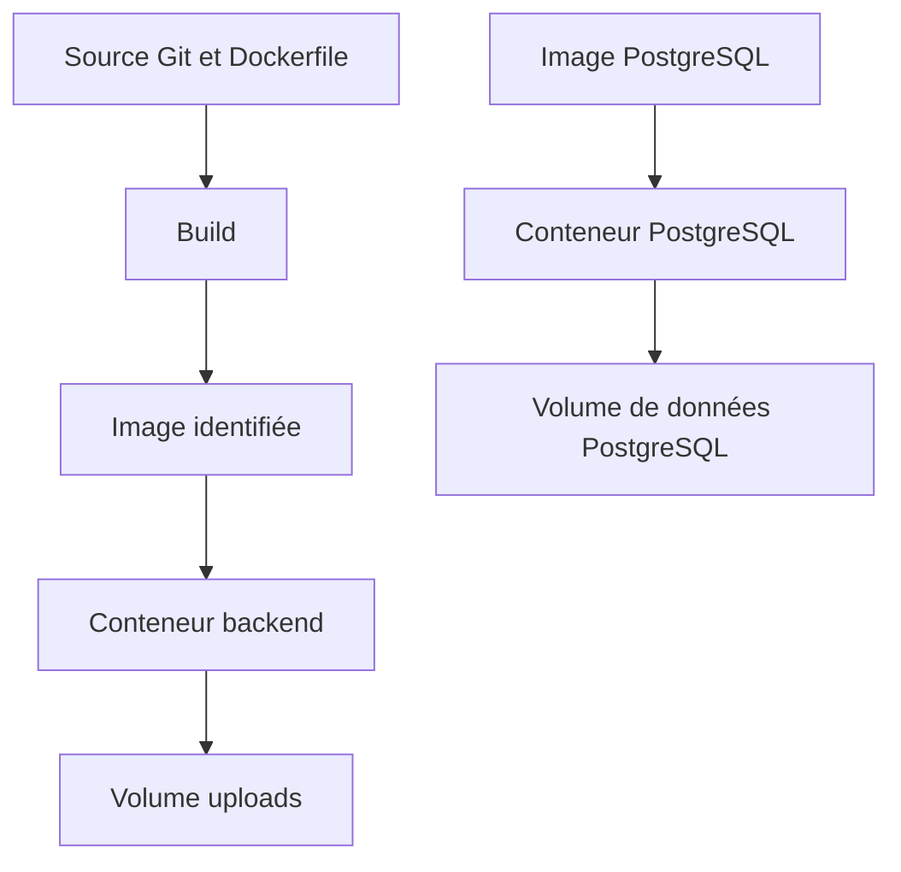

# Cours 02 — Images, conteneurs, volumes et Docker Compose

[Précédent](01-du-poste-local-au-vps.md) · [Sommaire](README.md) · [Suivant](03-reseau-caddy-dockge.md)

## Objectif

Savoir expliquer ce que construit un build, ce que démarre Docker, où vont
les données et pourquoi une configuration Compose explicite est indispensable.
Ce cours décrit Tervo ; il ne propose ni Kubernetes ni un second orchestrateur.

Les commandes pédagogiques ci-dessous ne sont pas de nouvelles validations.
Les captures réelles sont dans [le journal 02](../../notes/backend/sprint7.6/INT-129/journal/02-releases-sauvegarde-rollback.md).

## 1. Les quatre objets à ne pas confondre

| Objet | Définition simple | Exemple Tervo |
|---|---|---|
| Source | Fichiers de code/configuration suivis dans Git | Python, Vue, Dockerfiles, Compose |
| Image | Ensemble de couches et métadonnées utilisé pour créer un conteneur | `tervo-backend:<SHA>` |
| Conteneur | Instance créée depuis une image, avec son état d'exécution | `int129-vps-…-backend-1` |
| Volume | Stockage dont la durée de vie n'est pas celle du processus | `postgres_data`, `uploads_data` |

Une image n'est pas un processus. Un conteneur arrêté existe encore.
Supprimer/recréer un conteneur n'implique pas de supprimer son volume nommé.
Inversement, supprimer le volume détruit les données qu'il contient, même
si l'image du programme existe toujours.



Les conteneurs partagent le noyau de l'hôte ; ce ne sont pas chacun une VM
complète. Leur isolation utilise des mécanismes Linux, mais un accès au daemon
Docker reste très privilégié.

## 2. Lire le build backend

Source : [Dockerfile backend](../../backend/Dockerfile#L1).

Le Dockerfile a deux étapes principales :

1. **Builder** : prépare Python et les dépendances avec `uv`, puis copie
   l'application et les migrations.
2. **Runtime** : fournit les bibliothèques système nécessaires, le venv et
   le code utile à l'exécution ; lance Uvicorn.

La séparation réduit ce qui doit être embarqué dans l'image finale. Elle
ne garantit pas automatiquement une image minimale ou sans vulnérabilité.
Les bibliothèques WeasyPrint restent nécessaires au rendu PDF.

### Les couches et le cache

Un build ne recommence pas toujours tout. Docker peut réutiliser les étapes
dont les entrées n'ont pas changé.

```text
Base Python épinglée
  → dépendances système
  → dépendances Python verrouillées
  → code applicatif
  → métadonnée de révision
```

Si l'on met une donnée qui change à chaque commit trop tôt, on peut invalider
inutilement les étapes suivantes. INT-129 a déplacé le label de révision
backend vers la fin du runtime : un nouveau SHA ne force plus à lui seul
un nouveau téléchargement APT.

`uv sync --frozen` utilise le lockfile sans le mettre à jour silencieusement.
`--no-group dev` exclut le groupe de développement. Les versions de référence
vivent dans [pyproject.toml](../../backend/pyproject.toml#L1) et
[uv.lock](../../backend/uv.lock#L1), pas dans une phrase du cours.

**Limite importante :** une base épinglée et un lockfile ne rendent pas
toutes les étapes bit-à-bit reproductibles. Les paquets Debian téléchargés
par APT restent une entrée mutable. D'où la conservation de l'image exacte
pour un rollback, plutôt qu'un rebuild supposé identique.

## 3. Lire le build frontend

Source : [Dockerfile frontend](../../frontend/Dockerfile#L1).

Le premier stage utilise Bun pour installer les dépendances verrouillées
et construire les fichiers statiques. Le second copie ces fichiers dans
Nginx. Le VPS n'a pas besoin d'un `dist/` préparé à la main sur le poste.

`VITE_API_BASE_URL` est un **paramètre de build** des assets du navigateur.
Il ne faut pas y mettre un secret. Changer une variable du conteneur après
la compilation ne réécrit pas automatiquement le JavaScript déjà construit.

Le frontend ne contient pas la base de données. Le navigateur exécute le
JavaScript et fait des requêtes vers une URL d'API ; ce réseau n'est pas le
réseau Docker vu depuis le backend. Ce point sera repris au chapitre 03.

## 4. Tag, digest, ID et label

| Élément | Rôle | Piège |
|---|---|---|
| Tag, par exemple `tervo-backend:<SHA>` | Nom pratique pour référencer une image | Un tag peut être réattribué |
| Digest d'une référence de registre `@sha256:…` | Identifier un objet publié précisément | Ne pas confondre digest de manifeste/index et ID local de configuration selon le moteur |
| `.Image` d'un conteneur / `.Id` d'une image inspectée | Identifier l'artefact effectivement utilisé dans l'environnement testé | Conserver la preuve du moteur réel, pas seulement le nom du tag |
| Label `org.opencontainers.image.revision` | Enregistrer le commit source annoncé | Ne suffit pas, seul, à prouver quel contenu s'exécute |

Le helper construit, contrôle le label de source, récupère les IDs exacts,
et crée des tags de secours. Il ne demande pas à Git de reconstruire A lors
du rollback. La recette a vérifié les IDs **et** les marqueurs A/B réels.

### Lire sans afficher de secrets — exemple à adapter sur une stack autorisée

```sh
docker image inspect --format '{{.Id}}' 'tervo-backend:SHA_A_ADAPTER'
docker inspect --format '{{.Name}} {{.Image}}' NOM_CONTENEUR_A_ADAPTER
```

Attendu : identifiants, code 0. Un nom inexistant produit une erreur : ne pas
le remplacer au hasard. Ne pas publier un `docker inspect` complet : il peut
contenir des variables privées.

## 5. Compose : une configuration commune, pas un déploiement magique

Source : [Compose Tervo](../docker-compose.yml#L1).

| Partie | Ce qu'elle définit |
|---|---|
| `services` | PostgreSQL, backend, frontend, migration ponctuelle |
| `image` / `build` | Artefact à utiliser et recette de construction |
| `environment` | Configuration transmise au processus du conteneur |
| `ports` | Publications sur l'hôte, distinctes des ports internes |
| `volumes` | Persistance ou fichiers hôte montés |
| `networks` | Réseaux de communication des services |
| `healthcheck` | Commande périodique donnant un état de santé |
| `depends_on` | Dépendance de démarrage, ici readiness PostgreSQL |
| `profiles: ["tools"]` | Service `migrate` hors du démarrage normal |

Compose ne garantit pas à lui seul l'ordre métier « backup avant migration,
migration avant exposition ». Le helper de release coordonne ce parcours.

### Fixer explicitement la cible — exemples à adapter, pas à lancer sur la prod

Depuis le checkout autorisé, avec son env privé déjà préparé :

```sh
CHECKOUT=/chemin/absolu/du/checkout
ENV_FILE="$CHECKOUT/deploy/.env"
PROJECT=nom_du_projet_autorise
docker compose --env-file "$ENV_FILE" -p "$PROJECT" \
  -f "$CHECKOUT/deploy/docker-compose.yml" config --quiet
```

| Option | Pourquoi elle compte | Succès attendu |
|---|---|---|
| `--env-file` | Choisir la source d'interpolation plutôt qu'un fichier découvert implicitement | Fichier régulier privé ; code 0 si modèle valide |
| `-p` | Fixer l'identité du projet et de ses ressources | Même projet pour toutes les opérations |
| `-f` absolu | Choisir le Compose indépendamment du répertoire du terminal | Pas de stack accidentelle |
| `config --quiet` | Valider sans afficher les valeurs résolues | Silence et code 0 ; refus = ne pas poursuivre |

Une variable exportée dans le shell peut primer sur le fichier env.
[Le validateur](../validate-env.sh#L17) refuse les exports
ambigus de la liste Tervo. Un fichier `.env` racine non vide est également
refusé par le helper. La configuration fait partie de la release.

## 6. Distinguer les commandes Compose

Les lignes ci-dessous sont des **formes complètes à adapter** avec les trois
variables précédentes. Les mutations exigent une fenêtre et une cible validées.

```sh
docker compose --env-file "$ENV_FILE" -p "$PROJECT" -f "$CHECKOUT/deploy/docker-compose.yml" ps
docker compose --env-file "$ENV_FILE" -p "$PROJECT" -f "$CHECKOUT/deploy/docker-compose.yml" logs --no-color backend
docker compose --env-file "$ENV_FILE" -p "$PROJECT" -f "$CHECKOUT/deploy/docker-compose.yml" build backend frontend
docker compose --env-file "$ENV_FILE" -p "$PROJECT" -f "$CHECKOUT/deploy/docker-compose.yml" create --no-build backend frontend
docker compose --env-file "$ENV_FILE" -p "$PROJECT" -f "$CHECKOUT/deploy/docker-compose.yml" up -d --no-build --no-deps --wait --wait-timeout 120 backend frontend
docker compose --env-file "$ENV_FILE" -p "$PROJECT" -f "$CHECKOUT/deploy/docker-compose.yml" stop backend frontend
```

| Commande | Effet | Attendu / conduite si erreur |
|---|---|---|
| `ps` | Lire les conteneurs du projet | Liste, code 0 ; vide ne prouve pas que le projet attendu a été ciblé |
| `logs` | Lire les sorties du processus | Logs, code 0 ; ne pas publier de secrets ou données réelles |
| `build` | Construire les images | Export final, code 0 ; n'est pas un démarrage réussi |
| `create --no-build` | Créer sans démarrer ni construire | Conteneurs created ; ne pas utiliser `--no-deps`, option invalide ici dans la recette |
| `up -d --wait` | Démarrer puis attendre les conditions de santé | Code 0 si prêt ; un unhealthy doit rester un échec |
| `--no-build` / `--no-deps` de `up` | Réutiliser les images et ne pas relancer les dépendances | Utilisés pour le secours HTTP, PostgreSQL reste en place |
| `stop` | Arrêter sans supprimer les conteneurs et volumes | Arrêt propre, données persistantes conservées |

`down` supprime des ressources du projet. Avec `--volumes`, il peut détruire
les données persistantes correspondantes : ce n'est jamais une commande de
rollback applicatif ou un remède générique à une erreur.

## 7. Volumes nommés et bind mounts

Dans Tervo :

- PostgreSQL conserve ses données dans un volume nommé.
- Les uploads ont leur propre volume nommé.
- Les scripts SQL sont des fichiers Git montés depuis l'hôte, en lecture seule.

Pour un bind, `source` appartient à l'hôte Docker ; `target` est le chemin
vu dans le conteneur. Pour un volume nommé, Docker gère l'emplacement réel.
Le préfixe de projet permet d'isoler plusieurs stacks sans mélanger leurs
volumes, à condition de ne pas fixer volontairement un nom global partagé.

Les binds SQL imposent `create_host_path: false` : si la source manque, on
veut une erreur, pas un dossier vide créé à la place d'un fichier SQL.
La divergence de rendu JSON entre les deux Compose a été qualifiée par
[un test réel](../../notes/backend/sprint7.6/INT-129/journal/04-gate-dockge.md), pas neutralisée aveuglément.

## 8. Up, healthy et fonctionnel

Trois niveaux :

1. **Up** : le processus tourne.
2. **Healthy** : la sonde configurée réussit.
3. **Fonctionnel sur le parcours testé** : les requêtes utiles réussissent.

Le [readiness backend](../../backend/app/core/health.py#L16) fait
un `SELECT 1` avec un délai limité ; il ne vérifie pas toutes les tables
métier. Le frontend teste la présence de l'entrée construite. Le helper
ajoute trois GET : readiness backend, health frontend et page de login.
Le test `/login → 503` a montré qu'un conteneur healthy pouvait encore
échouer au smoke. Un GET 200 sur la page ne prouve pas une connexion métier.

## 9. Questions d'entretien et exercices

**Pourquoi utiliser un volume plutôt que l'image pour les uploads ?**

Parce que les uploads changent pendant l'usage. Leur durée de vie doit être
indépendante de l'image et de la recréation du conteneur.

**Pourquoi garder les IDs exacts si les images ont déjà un tag Git ?**

Le tag est un nom mutable. Le record et l'ID observé permettent de vérifier
l'artefact réutilisé et d'éviter un rebuild prétendument identique.

**Pourquoi deux Dockerfiles/stages alors qu'il n'y a qu'un VPS ?**

La séparation concerne les artefacts et les dépendances, pas le nombre de
machines. Le backend Python et les assets frontend n'ont pas les mêmes besoins.

Exercices sans exécution :

1. Le conteneur PostgreSQL a disparu, mais son volume existe : les données
   sont-elles nécessairement perdues ?
2. Une image est construite et taguée : peut-on annoncer une release réussie ?
3. Pourquoi un changement d'URL API du frontend peut-il nécessiter un build ?

Réponses : 1. Non, un conteneur compatible peut remonter le volume ; cela
demande une procédure contrôlée. 2. Non, il manque migrations/démarrage/tests.
3. Parce que l'URL est intégrée aux assets pendant la compilation.
