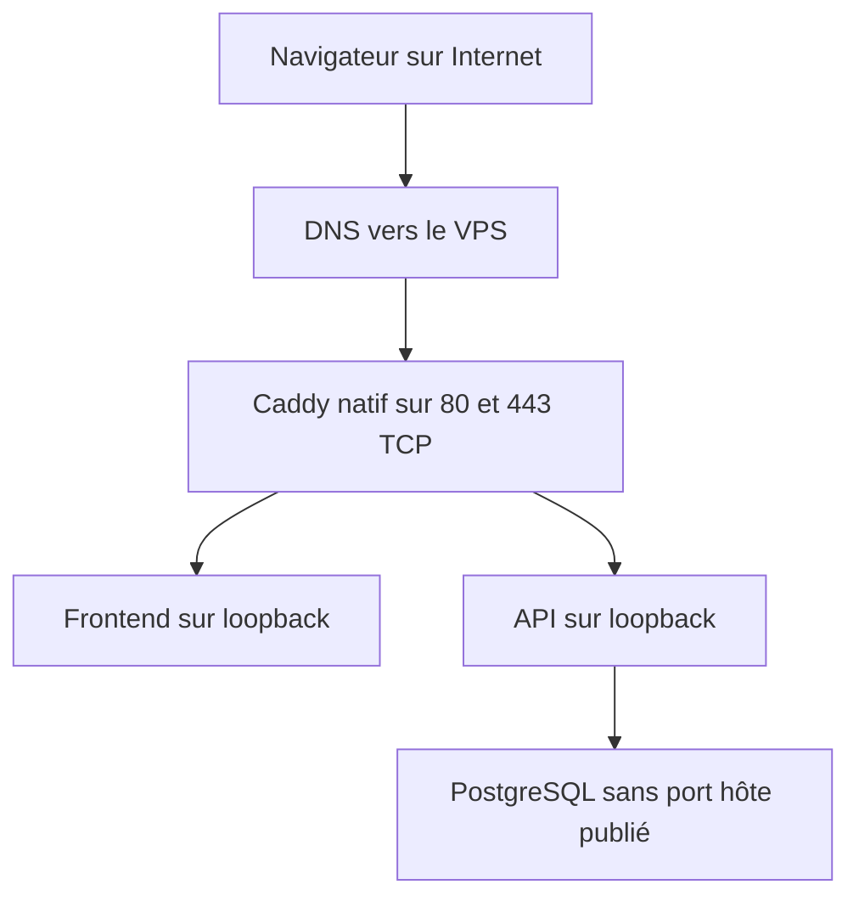
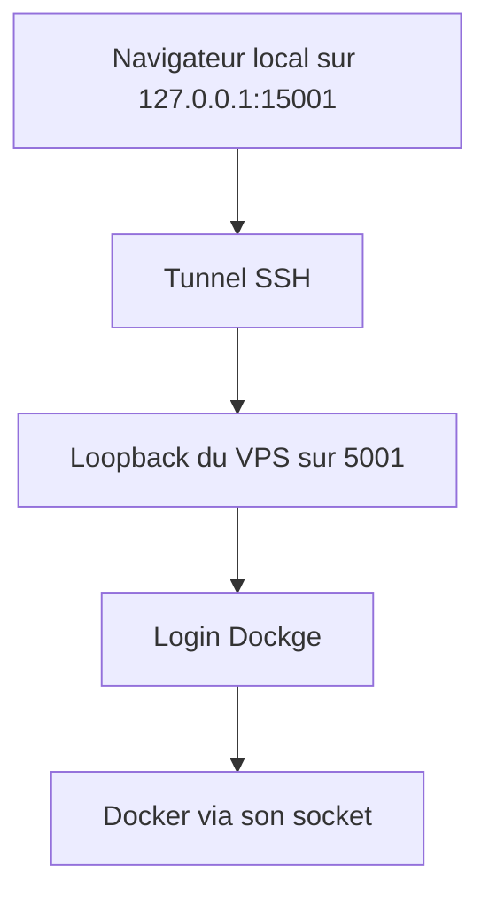

# Cours 03 — Réseau, reverse proxy, Caddy et Dockge

[Précédent](02-images-conteneurs-compose.md) · [Sommaire](README.md) · [Suivant](04-postgresql-migrations-sauvegardes.md)

## Objectif

Pouvoir dessiner le trajet d'une requête, expliquer pourquoi un service peut
être actif sans être public, et distinguer proxy, console d'administration
et moteur de conteneurs. Les exemples de lecture sont à adapter ; ils ne
constituent pas de nouvelles vérifications exécutées pour ce cours.

## 1. Adresse IP, port, processus : trois notions

Une IP identifie une interface ou une destination réseau. Un port identifie
un point d'entrée de transport sur cette destination. Un processus écoute
sur une adresse et un port.

Exemple : `127.0.0.1:19829` signifie « port 19829 de la boucle locale de
**la machine qui fait la requête** ». Dans ton navigateur local, cette adresse
ne désigne pas automatiquement le VPS.

| Adresse | Sens dans un contexte réseau donné |
|---|---|
| `127.0.0.1` | Boucle locale IPv4 |
| `::1` | Boucle locale IPv6 |
| `0.0.0.0` pour une écoute | Toutes les interfaces IPv4 de cet espace réseau |
| IP publique du VPS | Destination accessible par Internet, sous réserve d'écoute, routage et filtrage |
| Nom `postgres` dans Compose | Nom de service résolu sur le réseau Docker partagé, pas un nom public Internet |

Le conteneur possède son propre contexte réseau. Uvicorn peut donc écouter
sur `0.0.0.0:8000` **dans le conteneur**, tandis que Docker ne publie son
port que sur `127.0.0.1:19829` **sur l'hôte**.

## 2. Publication de ports et réseaux internes

Extrait conceptuel fidèle au [Compose](../docker-compose.yml#L59) :

```yaml
ports:
  - "127.0.0.1:${BACKEND_PORT:-8000}:8000"
```

De gauche à droite : adresse de l'hôte, port de l'hôte, port du conteneur.
Dans la recette, `BACKEND_PORT=19829`. Dans la stack `tervo` déployée en
INT-111, les ports de service sont 8000/3000 sur loopback. Il ne faut pas
mélanger ces contextes.

PostgreSQL n'a pas de `ports` publié. Le backend le joint sur le réseau
Docker `database` via son nom de service et le port interne PostgreSQL.
Cela réduit l'exposition, mais ne remplace pas les rôles/mots de passe SQL.

Le frontend statique et le backend ne doivent pas nécessairement partager
un réseau Docker : c'est le **navigateur** qui effectue les appels API.
Dans l'architecture publique cible, il passe par le domaine API et Caddy.

### Lire les écoutes — VPS, permissions adaptées, sans mutation

```sh
ss -ltn
docker ps --format '{{.Names}} | {{.Ports}}'
```

| Commande | But | Résultat attendu / limite |
|---|---|---|
| `ss -ltn` | Sockets TCP en écoute, adresses numériques | Liste, code 0 ; ce n'est pas à elle seule un test d'accessibilité depuis Internet |
| `docker ps … Ports` | Publications déclarées pour les conteneurs actifs | Liste, code 0 ; lire aussi les interfaces d'attache |

Ces sorties sont pédagogiques à lire sur une cible autorisée. Les
observations réellement reçues sont dans les journaux, pas inventées ici.
Un pare-feu doit être examiné avec les règles Docker : ne pas croire qu'une
configuration UFW suffit toujours à neutraliser une publication Docker large.

## 3. Caddy : la porte HTTP, pas le gestionnaire de stack

Un reverse proxy reçoit une requête puis la transmet à un service interne.
Il permet notamment de centraliser les noms de domaine et la terminaison TLS.

### Architecture publique de la démo — HTTPS vérifié



DNS indique où joindre le service ; il ne lance pas l'application et ne
crée pas un certificat. TLS chiffre le transport et participe à
l'authentification du serveur ; il ne remplace pas l'authentification métier.

### Cloudflare : trois fonctions indépendantes

| Fonction | Rôle | Situation Tervo |
|---|---|---|
| DNS | Publier les adresses/cibles des noms | Conservé chez Cloudflare ; cible web VPS en DNS seul |
| Tunnel | Relier un service à Cloudflare via une connexion sortante | Ancien mini-s1, pas la cible VPS |
| Email Routing | Transférer le courrier des alias vers une boîte existante | Réception `admin@` et `contact@` confirmée par l'opérateur |

`A`/`AAAA` portent des adresses IP ; `CNAME` fait pointer un nom vers un autre ;
`MX` désigne les serveurs de réception email ; `TXT` peut porter des règles
d'authentification mail. Modifier le web ne demande pas d'effacer les MX/TXT.
Un alias `admin@` fonctionnel n'est ni un compte Tervo ni un certificat HTTPS.
Le routage entrant seul ne permet pas de répondre sous cet alias.

### Pourquoi l'API doit aussi être publique en HTTPS

La page et l'API ont deux origines (`https://tervoapp.com` et
`https://api.tervoapp.com`). Le navigateur utilise l'URL API intégrée au build,
pas le nom Docker `postgres` ni le loopback du VPS. L'API autorise l'origine
frontend par CORS ; CORS n'est ni un mot de passe ni un pare-feu.
Une page HTTPS appelant une API HTTP peut être bloquée comme contenu mixte.
Si `/login` s'affiche mais la connexion échoue, examiner la requête API dans
le navigateur avant de conclure à un problème de mot de passe.

### Ce qui est actif aujourd'hui dans le périmètre décrit

Le [bootstrap Caddy](../caddy/bootstrap.Caddyfile#L1) était le profil initial
INT-131, HTTP seul sans routage public Tervo. Il est conservé comme référence,
pas comme état actuel après la publication INT-111.

Le [profil production](../caddy/production.Caddyfile.example#L1)
a été copié vers le Caddyfile actif lors de la mise en service autorisée.
Les certificats Let's Encrypt des deux domaines, redirections HTTP et GET
HTTPS ont ensuite été vérifiés. Le fichier du dépôt n'est pas un import
dynamique : sa seule présence n'aurait pas prouvé l'activation.

HTTP/3 est désactivé dans les profils concernés : le périmètre réseau retenu
reste 22, 80 et 443 **TCP**, sans ouverture UDP ajoutée par facilité.

## 4. systemd : gérer Caddy sur l'hôte

systemd gère le cycle de vie d'un service Linux : lancement, arrêt,
activation au boot et journaux. Ici Caddy est natif sous systemd, alors que
Tervo et Dockge sont des conteneurs. Il faut donc choisir le bon outil.

### Commandes de lecture — VPS

```sh
systemctl is-active caddy
systemctl show caddy -p ActiveState -p FragmentPath
journalctl -u caddy --since "10 minutes ago" --no-pager
```

| Commande | But | Attendu / attention |
|---|---|---|
| `is-active` | Lire l'état courant | `active`, code 0 si actif ; un code non nul demande diagnostic |
| `show -p` | Lire quelques propriétés, pas toute la configuration | État et chemin de l'unité, code 0 |
| `journalctl -u … --since` | Limiter la lecture au service et à une période pertinente | Journaux ou absence de lignes ; des droits supplémentaires peuvent être nécessaires |

Lire le journal ne veut pas dire le partager intégralement. Les domaines,
adresses et détails de requêtes peuvent être privés.

`systemctl stop caddy` est une **mutation avec interruption**. Dans INT-129,
elle était autorisée pour la capture cohérente. Caddy était repris ensuite.
Ce n'est pas une commande de diagnostic anodine à lancer sans fenêtre.

### Avant l'application : entretenir et protéger le VPS

Le déploiement commence avant Compose. Les travaux précédents ont concerné
le système Debian, SSH, les mises à jour et le filtrage. Leur
[journal de sécurité](../../notes/backend/deploy/vps/02-preparation-securite-systeme.md)
conserve les commandes et résultats historiques ; ce ne sont pas des
opérations à rejouer pendant la lecture du cours.

| Mécanisme | Problème traité | Ce qu'il ne remplace pas |
|---|---|---|
| Mises à jour de paquets | Corriger des vulnérabilités et défauts connus | Tests applicatifs et plan de maintenance |
| Reboot après nouveau noyau | Démarrer effectivement le noyau installé | Le simple fait que le paquet existe sur disque |
| UFW | Exprimer des règles de filtrage réseau sur l'hôte | Vérification des publications Docker et, le cas échéant, du pare-feu fournisseur |
| fail2ban | Réagir à certaines séries d'échecs selon les journaux et règles configurés | Authentification solide et contrôle des privilèges |
| unattended-upgrades | Automatiser certaines mises à jour autorisées | Vérification des origines, de la périodicité, des journaux et des redémarrages nécessaires |

**Installer un paquet n'est pas valider sa configuration.** Dans l'historique,
UFW a d'abord été installé mais inactif. De même, un service de mise à jour
actif ne suffisait pas à prouver que les paramètres périodiques et les dépôts
Security étaient corrects. Les métadonnées APT et leurs contrôles temporels
ont été examinés plutôt que d'interpréter « aucun paquet restant » comme une
preuve absolue de sécurité.

Exemples de lecture sur le VPS autorisé, non exécutés pour ce cours :

```sh
uname -r
uptime -s
systemctl is-enabled caddy
sudo ufw status verbose
sudo fail2ban-client status sshd
systemctl list-timers apt-daily.timer apt-daily-upgrade.timer --no-pager
apt-cache policy
```

| Commande | Question | Retour attendu / contrôle |
|---|---|---|
| `uname -r` | Quel noyau est **actuellement** démarré ? | Version, code 0 ; comparer au noyau prévu après maintenance |
| `uptime -s` | Depuis quand cet hôte a-t-il démarré ? | Date, code 0 ; indice à croiser, pas preuve suffisante de tous les services |
| `is-enabled caddy` | Le service doit-il revenir au boot ? | `enabled` pour la configuration retenue ; différent d'`active` |
| `ufw status verbose` | Quelles politiques et ouvertures sont effectivement actives ? | État/règles ; ne pas déduire leur activation de l'installation du paquet |
| `fail2ban-client status sshd` | La jail SSH est-elle chargée, quels compteurs observe-t-on ? | Statut ou erreur ; des compteurs ne permettent pas d'attribuer une attaque à une personne précise |
| `list-timers` | Les exécutions périodiques sont-elles planifiées ? | Dates/unités ; ne prouve pas que la dernière mise à jour a réussi |
| `apt-cache policy` | Quels dépôts/priorités sont pris en compte ? | Informations du cache ; ne télécharge ni n'installe les mises à jour |

### Pourquoi garder une porte de secours pour le pare-feu ?

Une mauvaise règle peut couper la connexion qui sert à réparer le serveur.
Le parcours historique a donc préparé les règles SSH avant activation,
conservé la session existante, prévu une désactivation temporaire de secours,
testé **une nouvelle connexion** avec UFW actif, puis annulé le secours.

La session existante seule ne suffisait pas : elle pouvait rester établie
alors que les nouvelles connexions étaient bloquées. Il ne fallait pas non
plus attendre le déclenchement du secours et appeler ensuite la reconnexion
« validation du pare-feu actif ». Cette logique de retour arrière contrôlé
est la même discipline que pour une release, appliquée au réseau.

Ce cours ne fournit pas de bloc d'activation du pare-feu à recopier : il
faudrait vérifier le contexte réel et une fenêtre autorisée. Aucun flush
global des chaînes Docker n'est une solution de dépannage proposée ici.

## 5. Dockge : une console Compose privée

Dockge facilite la consultation et certaines actions sur une stack Compose.
Il ne remplace ni Git comme source de vérité, ni SSH, ni systemd pour Caddy.

Son [Compose](../dockge/compose.yaml#L1) publie le port
5001 sur loopback et monte le socket Docker ainsi que `/opt/stacks` au même
chemin absolu. Ce dernier point compte pour les chemins de build et les binds.

### Accéder à la console — poste local

Avec la clé et la clé d'hôte approuvées, exemple de tunnel déjà utilisé dans
le projet :

```sh
ssh -N -o ExitOnForwardFailure=yes \
  -i "$HOME/.ssh/tervo_ed25519" \
  -L 127.0.0.1:15001:127.0.0.1:5001 \
  tervo@151.241.228.152
```

Puis navigateur local : `http://127.0.0.1:15001`.

| Élément | Rôle | Attendu / échec |
|---|---|---|
| `-N` | Ne pas ouvrir de shell distant ; transporter le tunnel | Terminal normalement silencieux et occupé, pas une commande courte censée rendre immédiatement la main |
| `-L local:destination` | Écouter localement et joindre la destination depuis le VPS | L'adresse de destination est le loopback **du VPS** |
| `ExitOnForwardFailure=yes` | Refuser un tunnel dont l'écoute n'a pas pu être créée | Un port local occupé produit un échec au lieu d'une fausse impression de succès |
| Login Dockge | Deuxième contrôle d'accès applicatif | Aucun mot de passe dans le chat |



Le tunnel ne publie pas Dockge sur Internet. Une route Caddy publique vers
Dockge n'a pas été ajoutée.

## 6. Pourquoi docker.sock est un sujet de sécurité

Le socket donne accès à une API puissante : créer des conteneurs, monter
des chemins hôte et agir sur les ressources du daemon. Le suffixe de montage
`:ro` ne transforme pas cette API en API read-only : on peut envoyer des
requêtes à travers un socket accessible.

La convention « consulter seulement » n'est donc pas un RBAC technique.
Dans la release, l'opérateur confirme l'absence d'action concurrente, puis
le helper gèle Dockge. Le verrou commun protège les outils coopérants,
pas un autre administrateur root qui déciderait de le contourner.

## 7. Pourquoi la compatibilité Dockge a demandé une preuve

Même nom de YAML ne signifie pas automatiquement même comportement :

- le répertoire courant peut changer les chemins ;
- un autre `.env` ou un export peut changer les valeurs ;
- le nom du projet peut créer d'autres volumes ;
- le Compose intégré à la console peut différer de celui de l'hôte.

La recette a donc comparé les modèles en mémoire, puis testé les actions
réelles de l'interface. Deux champs `create_host_path: false` étaient omis
du JSON de la console. On a vérifié le refus réel d'une source absente avant
de tolérer cette seule représentation dans la comparaison.

Les fichiers opérationnels et de secours conservent leurs `false`.
Les [preuves complètes](../../notes/backend/sprint7.6/INT-129/journal/04-gate-dockge.md) montrent ensuite logs,
Stop/Start, bonnes images, mêmes données et labels vers le wrapper Git.
Cette qualification ne s'étend pas automatiquement à toute future version.

## 8. Ne pas mélanger l'histoire et la cible actuelle

| Période / environnement | Ce qui lui appartient | Comment le présenter |
|---|---|---|
| Mini-s1 historique | 1Panel/OpenResty et Cloudflare Tunnel | Un environnement distinct de développement/démo |
| Évaluation initiale VPS | Installation privée de 1Panel/OpenResty | Historique conservé ; ne pas réexécuter sa procédure comme celle de Caddy |
| VPS après INT-131/132 | Caddy natif HTTP bootstrap, Dockge privé | État réellement installé |
| Recette INT-129 | App/PostgreSQL jetables, ports loopback, commandes de release testées | Pas une mise en service publique |
| INT-111, démo publique | Stack `tervo`, DNS direct, HTTPS, admin et recette navigateur ; backup manuel et récupération SQL/photos | Publication et récupération vérifiées ; pas une qualification clientèle réelle |
| Clôture / suite | Reboot, ports et TLS persistants vérifiés ; nettoyage ciblé exécuté et sorties consignées ; commit de livraison | Aucun timer ; TD-B024 impose destination permanente et automatisation avant les vrais clients |

Références historiques :
[transition Caddy](../../notes/backend/deploy/vps/04-transition-caddy.md),
[mini-s1/Cloudflare](../../notes/backend/deploy/cloudflare-tunnel-deploy.md).
Le choix est la simplicité d'exploitation d'un VPS, pas une démonstration
d'architecture distribuée ou de haute disponibilité.

La transition n'a pas consisté à effacer l'ancien proxy en espérant que le
nouveau fonctionne. Le journal INT-131 décrit une sauvegarde privée, une
bascule temporaire et un retour à l'ancien panneau/proxy, puis la bascule
finale et son contrôle après reboot. Le retrait de 1Panel/OpenResty a été
confirmé après ces étapes. Ces preuves historiques appartiennent à INT-131,
pas à la recette applicative INT-129.

## 9. Questions d'entretien et exercices

**Pourquoi Caddy natif plutôt que tout mettre derrière la console ?**

Caddy gère l'entrée HTTP/TLS publique ; Dockge gère une interface d'administration
privée. Séparer ces responsabilités rend les ports, permissions et chemins
d'exploitation plus explicites.

**Comment une API qui logue `0.0.0.0` peut-elle rester privée ?**

Il faut préciser l'espace réseau : l'écoute dans le conteneur et la
publication sur l'hôte sont deux opérations distinctes. Ici l'hôte publie
sur loopback, et la mise en service publique reste sous contrôle du proxy.

**Un tunnel SSH remplace-t-il le login Dockge ?**

Non. Le tunnel protège et limite le transport ; le login protège l'accès
à l'application. Les droits Docker derrière la console restent puissants.

Exercices sans mutation :

1. Dans le navigateur du poste, `127.0.0.1:8000` vise-t-il le backend du VPS ?
2. Un certificat présent dans un exemple de configuration prouve-t-il TLS ?
3. Quel outil utiliser pour lire l'état de Caddy ? Et celui du backend ?

Réponses : 1. Non, sauf redirection/tunnel explicitement configuré.
2. Non, il faut une configuration active et des contrôles réels.
3. systemd pour Caddy natif ; Docker/Compose pour le conteneur backend.
