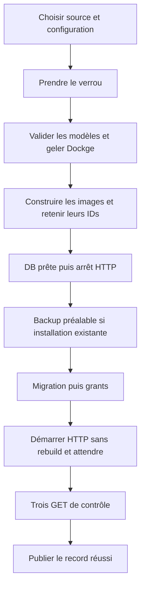
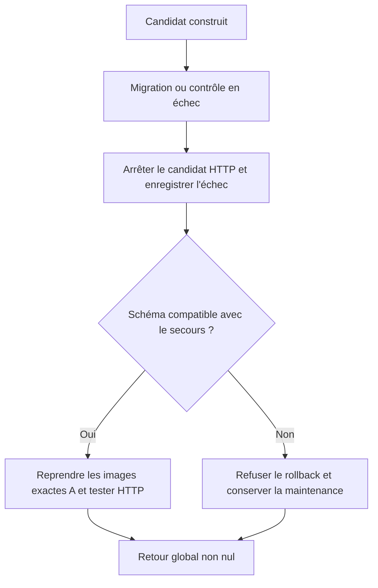

# Cours 05 — Release traçable, rollback contrôlé et entretien

[Précédent](04-postgresql-migrations-sauvegardes.md) · [Sommaire](README.md)

## Objectif

Comprendre le parcours de release sans devoir deviner ce que fait le Python,
raisonner sur les échecs et présenter le travail honnêtement en entretien.
Ce chapitre relie les notions des quatre précédents ; ce n'est pas une
nouvelle procédure à exécuter sur le VPS.

## 1. Déployer un programme ou effectuer une release ?

Un simple `docker compose up -d` peut démarrer un programme. Une release
contrôlée doit aussi répondre à ces questions :

1. Quelle source et quelle configuration suis-je en train de déployer ?
2. Est-ce que quelqu'un modifie déjà cette stack ?
3. Que faut-il sauvegarder avant de changer la base ?
4. Dans quel ordre puis-je migrer puis démarrer l'application ?
5. Quelles preuves rendent le candidat acceptable ?
6. Quel artefact exact puis-je reprendre si le candidat échoue ?
7. Qui décide si la base est compatible avec ce retour ?

INT-129 répond à ce besoin sur **un VPS avec Compose**, pas avec un nouveau
cluster ou un orchestrateur supplémentaire.

## 2. La source Git, la configuration et l'artefact forment un ensemble

| Élément | Rôle |
|---|---|
| Commit Git | Identifie les sources choisies |
| Checkout propre | Évite de construire des modifications non enregistrées |
| `.env` explicite et privé | Définit la configuration effective de la cible |
| Image construite | Fournit les octets effectivement exécutés |
| ID d'image | Permet de retrouver cet artefact exact |
| Record de release | Relie projet, source, images et empreinte de schéma/configuration |

Le nom du projet Compose n'est pas décoratif : il identifie aussi les
ressources à piloter. Deux noms peuvent créer deux bases différentes.
Le helper exige donc un projet cohérent avec le nom du dossier de stack.

Dans cette procédure, un commit Git **ne doit contenir ni secrets ni données
d'exploitation** : Git ne l'empêche pas magiquement. Le dossier d'état privé
ne doit pas être sous Git, car il conserve des modèles Compose résolus avec
des valeurs d'environnement.

## 3. Parcours nominal, étape par étape



Source : [deploy](../scripts/release.py#L160).

Pour lire les commandes natives sans commencer par le helper Python :

| Étape | Commande / référence expliquée |
|---|---|
| Valider le modèle | `docker compose … config --quiet`, [cours 02](02-images-conteneurs-compose.md) |
| Construire et démarrer | `build`, `create`, `up --wait`, `stop`, [cours 02](02-images-conteneurs-compose.md) |
| Faire évoluer la DB | `run … migrate`, puis `exec … psql -f …`, [cours 04](04-postgresql-migrations-sauvegardes.md) |
| Vérifier HTTP et les ports | `curl`, `ss`, `docker ps`, [guide opérateur](../../notes/backend/deploy/vps/05-tervo-release-et-exploitation.md) |

Les `…` de ce tableau sont des repères de lecture, pas des commandes à coller :
les liens donnent les lignes complètes, leurs préconditions et leurs retours.
Le helper ajoute l'ordre, le verrou, la conservation des images et les records
à ces outils natifs ; il ne remplace pas leur compréhension.

### Avant le build

Le helper prend un verrou non bloquant. Il valide l'env et compare les
entrées Compose locales, vérifie les chemins vus par Dockge et gèle la
console. L'opérateur doit avoir confirmé une fenêtre sans action parallèle.

Cette confirmation humaine reste nécessaire : un utilisateur root ou un
autre client du socket Docker peut contourner une convention de verrou.
L'outil n'est pas un système de RBAC.

### Build et conservation

Le backend et le frontend sont construits une fois pour ce candidat.
Le label de source est contrôlé et les IDs exacts sont enregistrables.
Des tags de secours retiennent les artefacts ; il n'y a pas de prune global
après chaque release.

Le build se fait avant de remplacer les services HTTP existants. Un build
raté ne doit donc pas faire disparaître A. C'est ce qu'a vérifié le test
Dockerfile `exit 42`.

### Maintenance, DB et migrations

Sur installation existante, l'application est arrêtée pour la capture,
puis les migrations sont exécutées et les droits réappliqués. Le service
`migrate` utilise le rôle administrateur, pas le rôle runtime de l'API.

La première installation refuse un projet ayant déjà des conteneurs ou
des volumes détectés : « l'opérateur affirme que c'est vide » ne suffit pas
à autoriser une réinitialisation implicite.

### Disponibilité et publication

Le démarrage HTTP utilise les images identifiées, sans rebuild.
`--wait` doit réussir, puis trois GET doivent répondre HTTP 200 avec un corps
non vide. Ce n'est qu'après cela que le record réussi et `current.json`
sont publiés.

La sonde backend teste une connexion DB avec `SELECT 1`. Les GET ne prouvent
pas tout le métier : la connexion admin, le dashboard ou un parcours réel
d'upload navigateur restent dans la recette de mise en service INT-111.

## 4. Lire la commande de release

**Exemple à adapter, non exécuté tel quel.** Préconditions : cible autorisée,
source propre choisie, fichier privé préparé, fenêtre réelle de maintenance,
console sans opération concurrente et droits suffisants.

```sh
CHECKOUT=/chemin/absolu/du/checkout
ENV_FILE="$CHECKOUT/deploy/.env"
PROJECT="$(basename "$CHECKOUT")"
STATE_DIR=/chemin/prive/hors-git/releases
LOCK_FILE=/run/lock/tervo-operations.lock
DOCKGE_ID=IDENTIFIANT_CONSOLE_VERIFIE
REVISION="$(git -C "$CHECKOUT" rev-parse HEAD)"

python3 "$CHECKOUT/deploy/scripts/release.py" deploy \
  --checkout "$CHECKOUT" \
  --env-file "$ENV_FILE" \
  --project "$PROJECT" \
  --state-dir "$STATE_DIR" \
  --lock-file "$LOCK_FILE" \
  --dockge-container "$DOCKGE_ID" \
  --console-idle-confirmed \
  --maintenance-confirmed \
  --revision "$REVISION"
```

| Argument | Usage | Contrôle attendu |
|---|---|---|
| `--checkout` | Source complète déjà positionnée ; le helper ne change pas de branche | Git propre et commit demandé |
| `--env-file` | Configuration du checkout, pas de secret sur la ligne de commande | Fichier privé explicite |
| `--project` | Même identité tout au long du parcours | Dossier, stack, volumes et records cohérents |
| `--state-dir` | Artefacts de contrôle privés hors Git | Dossier 700 appartenant à l'opérateur |
| `--lock-file` | Verrou commun release/backup | Refus immédiat s'il est tenu |
| `--dockge-container` | Console réelle à contrôler/geler | Référence épinglée et montage identique |
| `--console-idle-confirmed` | Confirmation d'absence d'action en cours | Ne pas passer ce flag sans la fenêtre correspondante |
| `--maintenance-confirmed` | Confirmation d'arrêt des autres écrivains/exposition | Ne configure pas Caddy à la place de l'opérateur |
| `--revision` | Commit choisi, également attendu dans l'env | Label VCS des images contrôlé |

Attendu illustratif : des étapes Docker/SQL, puis `PASS` des GET et de la
release, code global 0. Un échec ne se corrige pas en relançant la commande
en boucle ou en supprimant les volumes.

Les formes exactes utilisées et leurs sorties sont dans
[le journal 02](../../notes/backend/sprint7.6/INT-129/journal/02-releases-sauvegarde-rollback.md).

## 5. Que contiennent les records ?

| Fichier privé | Fonction | Ce qu'il ne faut pas en déduire |
|---|---|---|
| `current.json` | Référence la release active enregistrée | Pas un inventaire complet des données métier |
| `ID/record.json` | Projet, révision, images, empreintes | Pas une autorisation de retoucher les IDs à la main |
| `ID/compose.json` | Modèle résolu, sans build pour les images applicatives de secours | Contient des secrets ; ne pas le publier |
| `ID/before-migration.tar` | Capture préalable d'une installation existante | Pas une copie hors site ni une garantie de restauration |
| `ID/failed.json` | Identifie le candidat échoué et l'état connu | Ce candidat n'est pas une release réussie |

**Limite observée en INT-111 :** tous les échecs ne créent pas `failed.json`.
Le démarrage PostgreSQL se trouve avant le bloc qui écrit ce record d'échec.
Un arrêt à ce stade peut donc laisser un dossier de tentative, des tags de
secours et un volume, sans `current.json` ni `failed.json`. L'absence de record
n'autorise ni à déclarer la cible vide ni à supprimer ses données.

Les écritures JSON passent par un fichier temporaire privé puis un remplacement
du fichier cible. Cela évite une publication ordinaire partielle du JSON,
mais ne transforme pas toute l'opération Docker/DB en transaction unique.

Le [chargement d'un secours](../scripts/release.py#L130)
vérifie notamment le projet, les permissions, l'empreinte du modèle et la
présence des images. Les fichiers privés ne doivent pas être modifiés pour
forcer un succès.

## 6. Rejeu idempotent : ce que cela signifie ici

Dans le parcours testé, si commit, configuration, images et schéma correspondent
déjà au record actif, le helper ne reconstruit pas et ne remigre pas :

```text
PASS: backend readiness, frontend health and login page
Already released; no rebuild or migration
```

Cette sortie a été réellement observée après réconciliation.
L'idempotence n'est pas « ignorer tout ce qui a changé » : une dérive des
images ou du schéma doit au contraire conduire à un refus/diagnostic.
Le helper peut encore demander le démarrage des services et vérifier HTTP.

### Première installation échouée ≠ rejeu d'une release réussie

En INT-111, le premier essai a construit les images mais échoué sur la lecture
du SQL d'initialisation. Aucun record de succès n'existait. Le volume créé
aurait fait refuser une nouvelle « première release », même si PostgreSQL
était devenu healthy. Il fallait diagnostiquer les logs et permissions, puis
choisir une reprise explicite — pas considérer le helper comme une transaction
annulant tout ou utiliser `--recover-from` sans record compatible.

La reprise du projet neuf a réussi, puis l'admin a été créé. **Ces données
doivent maintenant être conservées.** Les détails et limites de cette preuve
sont dans le [journal INT-111](../../notes/backend/sprint7.6/INT-111-deploiement-vps.md).

## 7. Rollback applicatif et compatibilité de la base

Source : [rollback](../scripts/release.py#L148) et
[empreinte de schéma](../scripts/release.py#L73).

Avant de remplacer HTTP, le helper compare une empreinte construite à partir :

- d'un dump de structure PostgreSQL ;
- de la tête Alembic.

L'identité du schéma/tête est une **politique conservatrice**. Une simple
table ajoutée peut être compatible avec l'ancien code, mais le helper préfère
refuser une divergence plutôt que prétendre analyser toutes les migrations.
Inversement, un schéma identique ne prouve pas toutes les compatibilités
possibles de données, d'API ou de logique métier.

### Commande de secours — exemple à adapter

Avec les variables et préconditions précédentes, et un record existant validé :

```sh
RELEASE_ID=IDENTIFIANT_DU_RECORD_DE_SECOURS
python3 "$CHECKOUT/deploy/scripts/release.py" rollback \
  --checkout "$CHECKOUT" \
  --env-file "$ENV_FILE" \
  --project "$PROJECT" \
  --state-dir "$STATE_DIR" \
  --lock-file "$LOCK_FILE" \
  --dockge-container "$DOCKGE_ID" \
  --console-idle-confirmed \
  --maintenance-confirmed \
  --release-id "$RELEASE_ID"
```

Attendu : code 0, images exactes de secours et trois GET réussis.
Le rollback ne fait ni `git checkout`, ni rebuild, ni remplacement de
PostgreSQL, ni downgrade, ni restauration de données.

Si le schéma diffère : conserver la maintenance et diagnostiquer un
roll-forward ou une récupération contrôlée. `--recover-from` existe dans
le code mais n'a pas été exercé ; il est **hors du parcours validé**, pas
un bouton « force » conseillé par ce cours.

## 8. Pourquoi le secours réussi ne rend pas le déploiement vert



Le `PASS` du secours répond à « A fonctionne-t-elle à nouveau ? ».
Le code global répond à « le candidat a-t-il été livré ? ». Ces deux
questions doivent rester distinctes, notamment pour une future CI.

Dans la recette :

- build refusé : A reste en place ;
- migration défaillante avant DDL : A est reprise automatiquement ;
- candidat unhealthy : A est reprise ;
- `/login` répond 503 alors que la santé de base passe : A est reprise ;
- tous ces candidats gardent un code global 1.

Les [commandes et sorties complètes](../../notes/backend/sprint7.6/INT-129/journal/03-garde-fous-et-echecs.md)
montrent les assertions de cause et de code, pas seulement un message rassurant.

## 9. Réconciliation : le problème oublié après beaucoup de rollbacks

Après un retour aux images A :

```text
Application active : A
Checkout et .env : peuvent encore désigner B ou le candidat défaillant
```

Si l'UI relance alors la source/configuration courante, elle peut annuler
le secours. Dockge reste donc gelé après échec ou rollback.

La recette a créé une branche attachée à A, rétabli les deux champs
tag/révision du `.env`, rejoué A sans build/migration, puis seulement
redémarré la console. `master` gardait B ; les branches d'erreur restaient
distinctes. Aucun historique partagé n'a été réécrit.

Le helper ne peut pas inventer l'intention Git de l'opérateur : la
réconciliation est une action explicite, documentée et vérifiée.

## 10. Le rôle futur de la CI/CD

Une CI peut vérifier les tests et les builds. Une CD peut déclencher la
commande de release déjà validée. Ce sont deux sujets distincts.
Exemple concret : la [CI de `291f7ea`](https://github.com/libileh91/tervo/actions/runs/39025284922)
a terminé avec succès ; la release VPS a été lancée manuellement par
l'opérateur, et le premier essai a pourtant échoué sur les permissions SQL.
La CI ne contrôlait pas les modes des fichiers du checkout sur le VPS.

Le choix du projet est de construire sur le VPS pour la release concernée,
sans introduire GHCR dans ce périmètre. L'automatisation INT-130 réutilise ce
chemin, sans inventer une deuxième orchestration.

**Ce que INT-130 ajoute, et ce qui reste à prouver :** un job CI conditionné par
`DEPLOY_ENABLED`, une clé dédiée et une empreinte d'hôte vérifiée avant l'SSH.
La CI ne construit aucune image : le VPS exécute `release.py` par un wrapper
root borné. Détail des permissions, commandes d'installation et limites :
[note INT-130](../../notes/backend/sprint7.6/INT-130-ci-cd.md). Tant que le
déploiement réel n'est pas observé, « la CI/CD est automatisée » reste une
configuration, pas une preuve.

La recette INT-129 ne livrait pas cette automatisation :

- une CI verte avec déploiement sauté ne prouve pas un déploiement ;
- la clé CI est distincte de la clé personnelle ;
- l'identité SSH du serveur, les permissions et les secrets sont cadrés
  explicitement ;
- la mise en service manuelle INT-111 précède cette automatisation.

Les preuves HTTP de recette ne remplacent pas DNS/TLS public, bootstrap
admin, login métier et parcours navigateur complet.
Pour INT-111, publication HTTPS et recette navigateur sont désormais confirmées.
Le backup manuel hors VPS, la récupération SQL/photos et le retour après reboot
sont aussi validés ; le nettoyage ciblé des ressources de recette a été exécuté
et ses sorties consignées dans le journal INT-111. Le lot accepté est une démo,
avec automatisation des sauvegardes reportée avant clientèle réelle.

## 11. Présenter le travail à l'entretien

### Pitch honnête en une minute

> J'ai préparé une release Compose traçable pour Tervo sur un VPS. Le parcours
> utilise un commit et un env explicites, conserve les images exactes, prend
> une sauvegarde cohérente avant migration et ne valide le candidat qu'après
> les contrôles de santé et HTTP. J'ai testé une mise à jour puis un rollback,
> les refus de verrou et de schéma, ainsi que les échecs build, migration et
> disponibilité, sur des données fictives. Dockge reste une console privée,
> pas une seconde source de configuration. La mise en service publique et
> l'automatisation CI/CD restent distinctes de cette recette. Mon cœur de
> travail est le backend et la migration Excel ; cette partie montre comment
> j'encadre leur exploitation sans la présenter comme de la haute disponibilité.

### Questions fréquentes

**Pourquoi ne pas tout faire dans Dockge ?**

Pour garder Git et une commande commune comme références, et éviter les
modifications UI cachées. Dockge apporte consultation et opérations utiles,
mais doit utiliser le même modèle et être gelé pendant la release.

**Comment sais-tu que tu es revenu à la bonne version ?**

J'ai comparé les IDs complets des images actives avec le record A et vérifié
les marqueurs réellement servis. Un nom de branche ou un tag seul ne suffit pas.

**Qu'as-tu vraiment prouvé sur les sauvegardes ?**

La capture, l'intégrité du bundle et certaines restaurations isolées ont des
preuves distinctes. La capture VPS inclut de vrais paramètres hôte, mais
leur restauration réelle et une stratégie hors site opérationnelle ne sont
pas démontrées par ce seul fichier.

**Pourquoi autant insister sur un code non nul ?**

Parce qu'un secours réussi ne doit pas masquer un candidat raté. Sinon un
opérateur ou une CI pourrait croire que B a été livré alors que A est active.

**As-tu développé une plateforme distribuée ?**

Non. C'est une application modulaire et une stack sur un VPS, avec un
parcours d'exploitation contrôlé. Le différenciateur métier/technique reste
le pipeline de migration Excel, pas une survente de l'infrastructure.

**Qu'est-ce qui te manque encore ?**

La mise en service publique et sa validation métier, puis l'automatisation
prévue. Le nettoyage de recette est déclaré par l'opérateur, pas audité
indépendamment. Je ne revendique ni un SLA,
ni un RTO mesuré, ni la couverture de toutes les pannes possibles.

## 12. Exercices de raisonnement — facultatifs, sans exécution

1. B échoue, A fonctionne à nouveau, le processus retourne 0 : quel problème ?
2. Git est sur A mais l'image active a été reconstruite : est-ce la preuve
   d'un rollback exact ?
3. Une nouvelle colonne est compatible avec A : pourquoi le helper peut-il refuser ?
4. Dockge est arrêté après secours : quelle question poser avant `docker start` ?

Réponses :

1. L'échec du candidat est masqué, particulièrement pour la CI.
2. Non : il faut identifier l'artefact réellement utilisé, pas supposer un
   rebuild identique.
3. Le garde-fou compare une empreinte, il ne prouve pas la compatibilité
   sémantique de chaque évolution.
4. Les sources/env correspondent-ils à la release active, et les contrôles
   sont-ils passés ? La disponibilité de la console vient après cette cohérence.
