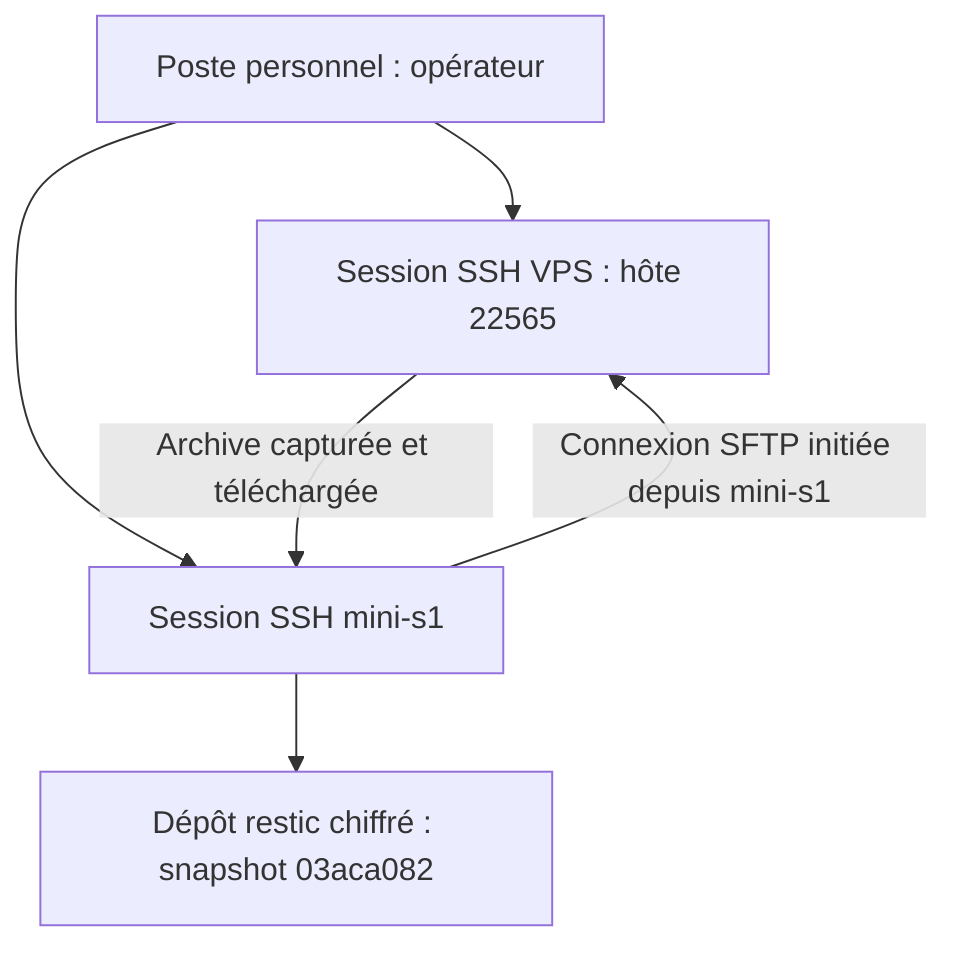
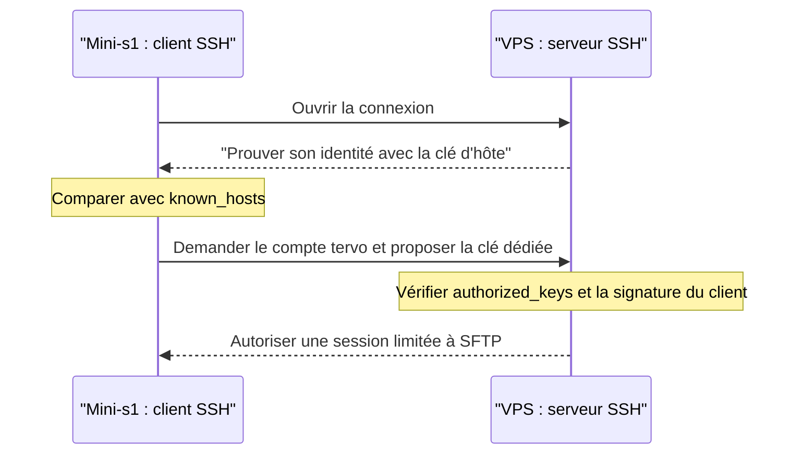

# Cours 06 — Après la recette : préparer les sauvegardes avec restic et SSH

[Sommaire](README.md) · [Bases Linux/SSH](01-du-poste-local-au-vps.md) ·
[Données et sauvegardes](04-postgresql-migrations-sauvegardes.md)

## Objectif et point d'arrêt

**Tervo fonctionnait déjà publiquement après le test frontend de bout en bout.**
Nous n'étions plus en train de le déployer : nous préparions sa récupération
en cas de panne ou de perte de données.

Ce cours reprend les bases, les commandes et les erreurs de cette préparation.
Il ne demande **aucune nouvelle opération maintenant**. Les dépôts et les clés
existent déjà : ne pas rejouer les créations comme si les machines étaient vides.

**État de reprise :** capture VPS réalisée, services revenus disponibles, archive
téléchargée et enregistrée sur mini-s1 dans restic : snapshot `03aca082`.
Empreinte de transfert conforme et lecture intégrale du dépôt sans erreur.
Le secret de secours est confirmé conservé hors mini-s1 par l'opérateur.
La première copie chiffrée hors VPS et la récupération SQL/photos en cible
isolée sur le VPS sont validées. Le périmètre de démo avec sauvegardes manuelles
est accepté ; l'automatisation est reportée avant la clientèle réelle (TD-B024).
Aucune reconstruction complète du proxy/console ou de clone HTTP n'est revendiquée.

### Lire les résultats sans confondre exemple et preuve

- **Observé** : sortie fournie par l'opérateur dans la conversation.
- **Attendu** : comportement normal de la commande, pas une nouvelle preuve.
- Les codes numériques n'ont pas été retranscrits dans les retours opérateur.
  « Code 0 attendu » ne signifie pas « code 0 explicitement reçu ».
- Une commande silencieuse peut réussir : vérifier son code et l'état obtenu,
  sans inventer un message `OK`.
- Aucun secret, clé privée ou mot de passe réel ne figure dans ce cours.
  Les empreintes abrégées avec `…` ne sont pas des valeurs à copier.

## 1. Trois machines, deux sens de circulation

| Machine | Nom / adresse | Rôle après la recette |
|---|---|---|
| Poste personnel | Machine depuis laquelle on ouvre les terminaux | Piloter les opérations |
| VPS | `22565`, `151.241.228.152` | Faire fonctionner Tervo ; fournir la future capture |
| Mini-PC local | `mini-s1`, `192.168.10.192` sur le LAN | Récupérer et conserver la sauvegarde chiffrée |



Le **mini-s1 ouvre la connexion**, mais les données viennent du VPS.
Le VPS n'a pas besoin d'une connexion entrante vers le LAN pour ce téléchargement.
Cela ne synchronise ni les applications ni les bases entre les deux machines.
L'ancien tunnel web Cloudflare n'intervient pas dans ce transfert SFTP.

### Avant toute commande : où suis-je ?

**Dans le terminal concerné — lecture seule :**

```sh
hostname
id
printf 'HOME=%s\n' "$HOME"
```

Attendu : un hostname, l'identité Linux et le dossier personnel, codes 0.
`sudo -i` change d'utilisateur, **pas de machine** :

```text
tervo@22565 → sudo -i → root@22565   : toujours le VPS
lob@mini-s1 → sudo -i → root@mini-s1 : toujours le mini-PC
```

**Incident observé :** le premier inventaire « mini-s1 » a affiché `22565`.
Il avait été lancé sur le VPS. Plus tard, le diagnostic du fichier
`/home/tervo/.ssh/authorized_keys` a été lancé sur mini-s1 : ce compte n'y
existait pas. Cela ne justifiait pas d'y créer `tervo` ; le fichier recherché
était sur le VPS.

### Lire les blocs shell du cours

| Syntaxe | Sens |
|---|---|
| `( ... )` | Sous-shell : une erreur du bloc ne doit pas fermer le terminal parent |
| `set -eu` | Arrêter sur beaucoup d'erreurs non traitées et refuser les variables non définies ; pas un mécanisme de restauration |
| `test ...` | Vérifier une condition ; code 0 si vraie, 1 si fausse |
| `>` / `>>` | Écrire en remplaçant / ajouter à la fin ; ce sont des mutations |
| `"$VARIABLE"` | Utiliser la valeur sans la découper sur ses espaces |

## 2. Pourquoi sauvegarder si le test frontend réussit ?

Le test fonctionnel répond : **« l'application fonctionne-t-elle maintenant ? »**
La sauvegarde répond : **« peut-on récupérer ses données après un incident ? »**
Ce sont deux preuves différentes.

| Élément à capturer plus tard | Pourquoi |
|---|---|
| Dump PostgreSQL | Comptes, données métier, relations et documents stockés en base |
| Uploads | Octets des photos et miniatures, absents du seul dump SQL |
| Environnement privé | Secrets et paramètres nécessaires à la reconstruction |
| Configuration et état Caddy | Routage, état TLS et paramètres du proxy |
| Configuration et données Dockge | Paramètres et authentification de la console |

Git conserve le code, **pas les données de production ni les secrets**.
Un volume Docker sur le VPS reste sur le VPS : sa présence ne protège pas
contre la perte de cette machine.

Le plan retenu est une **capture cohérente ponctuelle**, pas une réplication :

```text
VPS : base + fichiers + paramètres
             ↓ capture coordonnée
        archive privée
             ↓ téléchargement SFTP
mini-s1 : snapshot restic chiffré
             ↓ restauration SQL/photos vérifiée
        cible isolée, jamais la base de production
```

Une sauvegarde sur mini-s1 sort les données du VPS, mais ne protège pas de
tous les risques : perte du mini-PC, vol ou perte du secret restent possibles.
Créer le dépôt n'est donc que la préparation du contenant.

## 3. Restic : le contenant chiffré, pas encore la sauvegarde

### 3.1 Les quatre notions

| Notion | Signification dans notre parcours |
|---|---|
| Dépôt / repository | Structure restic dans `/srv/backups/tervo` sur mini-s1 |
| Secret restic | Mot de passe permettant de déverrouiller les clés du dépôt |
| Snapshot | État sauvegardé enregistré ; premier snapshot `03aca082` dans ce parcours |
| Restauration | Archive récupérée, puis données SQL et photos contrôlées sur une cible isolée |

Le secret restic n'est **ni une clé SSH, ni le mot de passe Linux, ni celui
de PostgreSQL**. Restic chiffre les données avant leur stockage dans le dépôt.
Une archive temporaire produite avant cette étape n'est pas automatiquement
chiffrée : permissions privées et chiffrement sont deux protections distinctes.

### 3.2 Inventaire exécuté — mini-s1, root, lecture seule

```sh
hostname
id
if command -v restic >/dev/null 2>&1; then
  restic version
else
  printf 'Restic absent du PATH\n'
fi
df -h /srv /var/tmp
for path in /srv/backups /srv/backups/tervo /etc/tervo; do
  if [ -e "$path" ]; then
    stat -c '%a %U:%G %n' "$path"
  else
    printf 'Absent : %s\n' "$path"
  fi
done
```

**Observé :** `mini-s1`, UID 0 ; 236 Go disponibles sur `/` ; restic absent ;
les trois chemins absents. Les deux lignes de `df` désignaient le même
filesystem : **pas deux réserves de 236 Go**.

| Commande | But / succès attendu | En cas d'écart |
|---|---|---|
| `command -v`, `restic version` | Trouver l'outil et sa version ; code 0 si disponible | Ne pas confondre absence d'outil et dépôt endommagé |
| `df -h` | Lire l'espace libre, code 0 | Vérifier le filesystem réel avant d'y stocker des données |
| `stat` | Lire mode/propriétaire, code 0 | Ne pas contourner un refus par `chmod 777` |

### 3.3 Installation exécutée — mini-s1, root

Le bloc vérifiait Debian/Ubuntu avant d'utiliser apt. **Historique, ne pas
réinstaller pour poursuivre cette session :**

```sh
(
  set -eu
  cat /etc/os-release
  . /etc/os-release
  case "$ID" in
    debian|ubuntu) ;;
    *) printf 'Distribution non prévue.\n' >&2; exit 1 ;;
  esac
  apt-get update
  apt-get install -y restic
  restic version
)
```

`update` actualise les index ; ce n'est pas une mise à niveau générale.
`install -y` installe restic et les dépendances choisies par apt.
Les deux commandes doivent réussir, code 0, avant la suite.

**Sortie finale observée :**

```text
restic 0.18.0 compiled with go1.24.4 on linux/amd64
```

La distribution détaillée n'a pas été retranscrite. La version 0.19.1 des
anciennes recettes locales n'est pas celle observée sur mini-s1.

### 3.4 Dossiers et secret : permissions et non-écrasement

Les commandes utilisées pour une préparation neuve comprenaient :

```sh
umask 077
install -d -m 700 /srv/backups /srv/backups/tervo /etc/tervo
```

Succès attendu : silence, code 0. Le secret a été généré localement avec
`openssl rand -base64 48`, redirigé vers un fichier privé sous `/etc/tervo/`,
sans affichage. Son nom a été masqué dans les échanges : **ne pas transformer
un marqueur de masquage en nom de fichier imposé**.

| Protection | Ce qu'elle signifie |
|---|---|
| Dossier `700` | Propriétaire seul autorisé à lister, écrire et traverser |
| Fichier `600` | Propriétaire seul autorisé à lire et écrire |
| `umask 077` | Retirer les droits groupe/autres des nouvelles créations ordinaires |
| `test ! -e ...` | Refuser de recréer une ressource déjà présente |
| `set -C` avant une redirection | Refuser l'écrasement d'un fichier ordinaire existant |

Les trois chiffres représentent propriétaire, groupe et autres.
Lecture = `4`, écriture = `2`, exécution/traversée = `1` :
`600` donne `4 + 2` au seul propriétaire ; `700` lui ajoute la traversée.

`600` ne chiffre pas le fichier et ne le cache pas à root. Le masque ne
modifie pas les anciens fichiers. Après un échec, les créations déjà faites
restent : **`set -e` n'est pas un rollback**.

### 3.5 L'erreur d'option et la reprise réellement effectuée

Un bloc fourni dans la conversation contenait un marqueur de masquage à la
place d'une option. Résultat : `unknown flag`. À ce moment-là, le fichier
privé existait déjà en `600 root:root`, mais la configuration restic du dépôt
était absente. **On a conservé le secret au lieu de le régénérer.**

La reprise ci-dessous utilise les variables natives de restic, sans option
contenant un placeholder. **Historique réussi, à ne plus rejouer :**

```sh
(
  set -eu
  test "$(hostname)" = mini-s1
  test "$(id -u)" = 0
  set -- /etc/tervo/restic-*
  test "$#" -eq 1
  test -f "$1"
  test -s "$1"
  test "$(stat -c '%a:%u' "$1")" = '600:0'
  unset RESTIC_PASSWORD RESTIC_PASSWORD_COMMAND RESTIC_REPOSITORY_FILE
  export RESTIC_REPOSITORY=/srv/backups/tervo
  export RESTIC_PASSWORD_FILE="$1"
  test ! -e "$RESTIC_REPOSITORY/config"
  restic init
  printf '\n--- Vérification du dépôt vide ---\n'
  restic snapshots
)
```

| Élément | Explication |
|---|---|
| `set -- /etc/tervo/restic-*` | Placer les chemins correspondants dans les arguments du shell |
| `"$#"` / `"$1"` | Nombre d'arguments / premier chemin ; exiger un seul fichier candidat |
| `-s` | Exiger un fichier non vide, sans en afficher le contenu |
| `unset ...` | Écarter d'autres sources de configuration susceptibles de brouiller le choix |
| `RESTIC_PASSWORD_FILE` | Indiquer un chemin, pas exposer le secret dans les arguments |
| `restic init` | Créer le dépôt une fois ; code 0 attendu |
| `restic snapshots` | Ouvrir le dépôt et lister les sauvegardes ; code 0 attendu |

Les variables sont définies dans un sous-shell `( ... )` : elles ne restent
pas configurées dans les prochains terminaux.

**Extrait observé :**

```text
created restic repository 4f50c482e6 at /srv/backups/tervo
repository 4f50c482 opened (version 2, compression level auto)
created new cache in /root/.cache/restic
```

À cette initialisation, aucun snapshot listé. Le cache n'est pas un deuxième dépôt ni une sauvegarde.
La copie du secret hors mini-s1 a ensuite été confirmée par l'opérateur :
perdre le dépôt **ou** le moyen de le déverrouiller peut rendre les sauvegardes inaccessibles.
Ne jamais publier le secret pour prouver sa conservation.

## 4. SSH depuis les bases : qui vérifie qui ?

SSH fournit une connexion chiffrée. SFTP est un protocole de transfert de
fichiers transporté par SSH ; ce n'est pas FTP et il n'exige pas ici de
nouveau port public.



Une clé privée sert à **prouver** sa possession ; elle n'est pas envoyée au
serveur. La clé publique permet de vérifier cette preuve. Une empreinte SHA-256
est une représentation courte de la clé publique, pas une troisième clé.

| Vérification | Question | Fichier principal |
|---|---|---|
| Identité du serveur | « Est-ce bien mon VPS ? » | `known_hosts` sur le client mini-s1 |
| Authentification du client | « Cette clé peut-elle utiliser le compte tervo ? » | `authorized_keys` sur le VPS |
| Autorisation de session | « Que peut faire cette connexion ? » | Options de cette clé dans `authorized_keys` |

### Les fichiers ne vivent pas tous sur la même machine

```text
MINI-S1 — client exécuté comme root
/root/.ssh/
├── known_hosts                     clé publique d'hôte du VPS reconnue
├── tervo-vps-ed25519.candidate      clé candidate, sans confiance implicite
├── tervo-vps-backup                 clé privée dédiée : ne jamais partager
└── tervo-vps-backup.pub             partie publique à autoriser sur le VPS

VPS — serveur SSH
/etc/ssh/ssh_host_ed25519_key.pub    clé publique identifiant le serveur
/home/tervo/.ssh/authorized_keys    clés publiques autorisées pour tervo
```

Le `root` local sur mini-s1 demande une connexion comme **`tervo` sur le VPS**.
Cela n'active pas SSH root distant et n'accorde pas automatiquement sudo.
La clé administrative `tervo-vps` reste distincte de la clé de sauvegarde.
Le compte Linux `tervo` n'est pas non plus le compte administrateur avec
lequel on s'est connecté à l'application dans le navigateur.

## 5. Première barrière : reconnaître le serveur VPS

### 5.1 Erreur observée

```text
No ED25519 host key is known for 151.241.228.152 and you have requested strict checking.
Host key verification failed.
```

Le client root de mini-s1 ne connaissait pas encore le serveur. L'authentification
du compte `tervo` n'était pas encore le problème. **Ne pas désactiver
`StrictHostKeyChecking` pour contourner ce refus.**

### 5.2 Lire la référence — session VPS déjà établie, root

```sh
hostname
ssh-keygen -lf /etc/ssh/ssh_host_ed25519_key.pub
cat /etc/ssh/ssh_host_ed25519_key.pub
```

Attendu : `22565`, une empreinte ED25519 et une clé commençant par
`ssh-ed25519`, codes 0. Le `.pub` est public ; le fichier sans `.pub` est privé.
L'opérateur a utilisé cette session existante comme canal de référence.
Les valeurs ont été masquées dans la conversation : la comparaison complète
est une confirmation opérateur, pas une comparaison faite par l'agent.

### 5.3 Récupérer un candidat — mini-s1, root

```sh
(
  set -eu
  test "$(hostname)" = mini-s1
  test "$(id -u)" = 0
  umask 077
  install -d -m 700 /root/.ssh
  ssh-keyscan -T 10 -t ed25519 151.241.228.152 \
    > /root/.ssh/tervo-vps-ed25519.candidate
  ssh-keygen -lf /root/.ssh/tervo-vps-ed25519.candidate
)
```

`-T 10` borne l'attente réseau ; `-t ed25519` choisit le type de clé.
`ssh-keyscan` collecte ce que le réseau présente : **il n'authentifie pas
à lui seul le serveur**. L'empreinte du candidat doit être strictement égale
à celle lue sur le VPS. Une nouvelle collecte impose de vérifier le nouveau
candidat avant de lui faire confiance.

### 5.4 Enregistrer seulement après comparaison — mini-s1

**Historique exécuté après confirmation d'empreintes identiques :**

```sh
cat /root/.ssh/tervo-vps-ed25519.candidate >> /root/.ssh/known_hosts
chmod 600 /root/.ssh/known_hosts
ssh-keygen -F 151.241.228.152 -f /root/.ssh/known_hosts
```

`>>` ajoute, il n'écrase pas les autres hôtes. `cat` et `chmod` sont normalement
silencieux, codes 0 attendus ; `ssh-keygen -F` doit trouver l'entrée, code 0.
La sortie a bien montré une entrée pour `151.241.228.152`.

**Erreur pédagogique rencontrée :** refaire uniquement `ssh-keyscan` ne
remplissait pas `known_hosts`. Le candidat existait, mais SSH continuait à
refuser l'hôte inconnu. Il manquait l'enregistrement après comparaison.

## 6. Deuxième barrière : autoriser le client mini-s1

Après reconnaissance du serveur, le message est devenu :

```text
tervo@151.241.228.152: Permission denied (publickey).
```

Cette progression est utile : identité du serveur acceptée, mais aucune clé
client proposée n'était encore acceptée pour le compte distant.

### 6.1 Création exécutée — mini-s1, root ; ne pas régénérer

```sh
(
  set -eu
  umask 077
  test "$(hostname)" = mini-s1
  test "$(id -u)" = 0
  KEY=/root/.ssh/tervo-vps-backup
  test ! -e "$KEY"
  test ! -e "$KEY.pub"
  ssh-keygen -t ed25519 -N '' -C 'mini-s1-tervo-backup' -f "$KEY"
  stat -c '%a %U:%G %n' "$KEY"
  cat "$KEY.pub"
)
```

| Option / fichier | Sens |
|---|---|
| `-t ed25519` | Type de paire de clés |
| `-N ''` | Passphrase vide pour permettre le transfert non interactif |
| `-C` | Commentaire lisible ; pas une permission |
| `-f` | Chemin de la clé privée ; la publique reçoit le suffixe `.pub` |
| Clé privée `600 root:root` | Protection locale ; ne pas la copier dans Git ou la conversation |

Sans passphrase, la protection au repos repose ici sur le système et ses
permissions ; les restrictions côté VPS réduisent ce que permet son usage.
Cela **ne désactive pas** l'authentification SSH par clé.

**Observé :** paire créée, clé privée `600 root:root`, empreinte dédiée
abrégée `SHA256:Nvx8…XkdCSw`. Le dessin « randomart » est une représentation
visuelle, pas une donnée nécessaire au transfert.

### 6.2 Comparer les bonnes empreintes

**Mini-s1, root :**

```sh
ssh-keygen -lf /root/.ssh/tervo-vps-backup.pub
```

**VPS, compte `tervo` ou root :**

```sh
ssh-keygen -lf /home/tervo/.ssh/authorized_keys
```

Attendu : l'empreinte de la **clé cliente dédiée** doit apparaître dans les
clés autorisées du VPS, codes 0. Elle ne doit pas être comparée à l'empreinte
de la **clé d'hôte**, qui représente une autre identité.

**Observé :** initialement, seul `tervo-vps`, empreinte `rEpEsq…aSZ2OVE`,
était reconnu côté VPS. Après ajout de la clé publique complète, les deux
empreintes apparaissaient, dont `Nvx8…XkdCSw`.
Les permissions du chemin étaient correctes : home et `.ssh` en `700`,
`authorized_keys` en `600`, appartenant à `tervo`.

## 7. Autoriser la clé ne suffit pas : limiter la session

Une clé ajoutée sans options donne les possibilités SSH ordinaires du compte.
Pour notre besoin, le mini-s1 doit **lire les fichiers préparés**, pas ouvrir
un shell d'administration.

### 7.1 Forme attendue dans `authorized_keys`

Sur le VPS, chaque autorisation occupe **une ligne physique**. Exemple
illustratif non copiable tel quel : remplacer la partie symbolique par la
clé publique complète, sans `…` ni texte de substitution.

```text
restrict,command="internal-sftp -R" ssh-ed25519 BASE64_COMPLET mini-s1-tervo-backup
```

| Élément | Effet |
|---|---|
| `restrict` | Désactiver notamment PTY, forwarding de ports/agent/X11 et `~/.ssh/rc` pour cette clé |
| `command="internal-sftp -R"` | Forcer le serveur SFTP intégré, en lecture seule |
| `ssh-ed25519 BASE64_COMPLET` | Type et véritable clé publique |
| Commentaire final | Repère humain, sans effet sur les droits |

**Limites :** ni chroot ni limitation à un dossier. La lecture reste celle
permise au compte `tervo`. Les futurs fichiers privés exportés devront donc
être placés avec des droits explicitement adaptés au transfert.
Les autres clés ne reçoivent pas ces restrictions par contagion.
La clé dédiée doit être conservée ou révoquée explicitement selon la suite ;
elle n'expire pas automatiquement.

L'édition s'est faite avec `nano /home/tervo/.ssh/authorized_keys`,
puis Ctrl+O, Entrée et Ctrl+X. Aucun redémarrage SSH n'est nécessaire pour
qu'une nouvelle connexion utilise le fichier modifié. Garder la session
d'administration existante ouverte pendant ces changements.

### 7.2 L'erreur importante : un vrai retour à la ligne

**Forme incorrecte réellement reçue :**

```text
restrict,command="internal-sftp -R"
 ssh-ed25519 BASE64_COMPLET mini-s1-tervo-backup
```

SSH n'appliquait pas la première ligne à la suivante : les options doivent
appartenir à la même entrée. **SFTP avait réussi, mais sans prouver la
restriction annoncée.** Un espace au début d'une autre ligne ne raccorde
pas deux lignes.

Un retour **visuel** automatique dans nano est différent : il peut montrer
sur deux lignes d'écran une seule ligne physique. Pour contrôler l'entrée :

```sh
grep -n '^restrict,command="internal-sftp -R" ssh-ed25519 .*mini-s1-tervo-backup' \
  /home/tervo/.ssh/authorized_keys
```

Attendu : une entrée avec un seul numéro de ligne, code 0 ; code 1 si aucune
entrée ne correspond. Ce contrôle lit la configuration ; il ne teste pas
à lui seul le comportement d'une nouvelle connexion.

### 7.3 Correction exécutée — VPS, compte `tervo`

Ce bloc réparait **la forme précise ci-dessus**, pas tous les fichiers SSH
possibles. Historique, ne pas rejouer inutilement :

```sh
(
  set -eu
  test "$(hostname)" = 22565
  FILE=/home/tervo/.ssh/authorized_keys
  BACKUP="$(mktemp /home/tervo/.ssh/authorized_keys.before-sftp.XXXXXX)"
  cp -p "$FILE" "$BACKUP"
  printf 'Sauvegarde : %s\n' "$BACKUP"
  sed -i '/^restrict,command="internal-sftp -R"$/{
    N
    s/\n[[:blank:]]*ssh-ed25519 / ssh-ed25519 /
  }' "$FILE"
  grep -n '^restrict,command="internal-sftp -R" ssh-ed25519 .*mini-s1-tervo-backup' "$FILE"
  ssh-keygen -lf "$FILE"
)
```

`mktemp` crée un nom unique ; `cp -p` conserve le contenu et ses métadonnées.
Dans sed, `N` lit la ligne suivante et la substitution remplace le retour
à la ligne et les blancs précédant `ssh-ed25519` par un espace.
`sed -i` modifie le fichier : ce n'est pas une commande de diagnostic.

**Extrait observé, clé abrégée uniquement pour le cours :**

```text
Sauvegarde : /home/tervo/.ssh/authorized_keys.before-sftp.Fe9gua
2:restrict,command="internal-sftp -R" ssh-ed25519 … mini-s1-tervo-backup mini-s1-tervo-backup
256 SHA256:rEpEsq…aSZ2OVE tervo-vps (ED25519)
256 SHA256:Nvx8…XkdCSw mini-s1-tervo-backup (ED25519)
```

Le commentaire en double est sans effet. La clé administrative est conservée.
La copie `authorized_keys.before-sftp.*` est une sauvegarde de ce petit
fichier d'accès : **pas une sauvegarde de Tervo**, ni un état à restaurer
aveuglément puisqu'il précède la correction.

## 8. Tester le bon service : SFTP, pas un shell distant

### Commande utilisée — mini-s1, root

```sh
sftp \
  -b - \
  -i /root/.ssh/tervo-vps-backup \
  -o IdentitiesOnly=yes \
  -o UserKnownHostsFile=/root/.ssh/known_hosts \
  -o StrictHostKeyChecking=yes \
  -o BatchMode=yes \
  -o ConnectTimeout=10 \
  tervo@151.241.228.152 <<'SFTP'
pwd
bye
SFTP
```

| Élément | Pourquoi |
|---|---|
| `-b -` | Lire les commandes SFTP sur l'entrée standard |
| `-i` | Choisir la clé privée dédiée |
| `IdentitiesOnly=yes` | Ne pas proposer d'autres identités chargées par défaut dans l'agent |
| `UserKnownHostsFile` | Choisir explicitement le fichier de confiance sur mini-s1 |
| `StrictHostKeyChecking=yes` | Refuser une identité d'hôte non approuvée |
| `BatchMode=yes` | Échouer plutôt que demander une authentification interactive |
| `ConnectTimeout=10` | Borne de connexion, pas limite de durée du futur téléchargement |
| `<<'SFTP'` | Envoyer les lignes suivantes sans expansion shell jusqu'au délimiteur final |
| `pwd`, `bye` | Afficher le dossier distant puis fermer ; aucun transfert |

**Sortie observée avant le raccordement final des options :**

```text
sftp> pwd
Remote working directory: /home/tervo
sftp> bye
```

Succès attendu : code 0. Cette sortie prouve la connexion et l'exécution de
ces deux commandes, **pas le téléchargement d'un fichier ni l'interdiction
d'écrire**. Aucun nouveau test après la correction finale n'est retranscrit.
Avec la commande forcée, `ssh ... 'id; hostname'` n'est plus le test adapté :
on n'a précisément pas autorisé un shell pour cette clé.

### Les erreurs rencontrées : trouver la bonne couche

| Message / constat | Couche en cause | Bonne réaction |
|---|---|---|
| `unknown flag` pendant restic | Commande incorrecte, pas forcément dépôt corrompu | Corriger la commande ; ne pas régénérer le secret |
| `No ED25519 host key is known` | Reconnaissance du serveur | Comparer puis enregistrer la clé d'hôte |
| Candidat présent, même erreur SSH | `known_hosts` pas encore rempli | Ne pas confondre collecte et approbation |
| `Permission denied (publickey)` | Authentification du client | Comparer clé dédiée et clés autorisées |
| Une seule empreinte côté VPS | Clé dédiée absente ou non reconnue | Ajouter/corriger cette entrée sans remplacer la clé admin |
| `/home/tervo` absent sur mini-s1 | Diagnostic sur la mauvaise machine | Vérifier `hostname`, retourner sur le VPS |
| Journaux SSH invisibles comme `tervo` | Droits de lecture du journal | Utiliser la session root autorisée si ces logs sont nécessaires |
| SFTP réussi, options sur une ligne séparée | Autorisation mal configurée | Raccorder les options à la clé et vérifier l'entrée |

Les commandes de diagnostic exécutées sur le VPS étaient :

```sh
hostname
getent passwd tervo
namei -l /home/tervo/.ssh/authorized_keys
ssh-keygen -lf /home/tervo/.ssh/authorized_keys
journalctl -u ssh.service --since '10 minutes ago' -n 30 --no-pager
```

`namei -l` détaille les permissions de chaque composant du chemin.
`journalctl` demande ici les événements SSH récents ; un avis de permissions
insuffisantes ne signifie pas « aucun événement ». Un code 0 ne suffit pas
non plus à valider les permissions : lire les propriétaires et les modes.
Ne pas multiplier les essais refusés, notamment à cause de fail2ban.

## 9. Bilan : où s'arrête exactement la preuve ?

| Étape | État réellement connu |
|---|---|
| Tervo public et recette navigateur | Réussis avant cette préparation ; recette confirmée par l'opérateur |
| Restic sur mini-s1 | Version 0.18.0 observée |
| Dépôt `/srv/backups/tervo` | Identifiant `4f50c482e6`, premier snapshot `03aca082` enregistré |
| Copie du secret restic hors mini-s1 | Confirmée par l'opérateur avant la capture autorisée |
| Identité d'hôte VPS depuis mini-s1 | Comparaison confirmée par l'opérateur, entrée enregistrée |
| Clé cliente dédiée | Créée, privée en 600 ; publique reconnue sur le VPS |
| Connexion SFTP | Téléchargement réel réussi après correction des options |
| Options de la clé | Dernière sortie : restriction et clé sur la même ligne |
| Restriction après correction | Commande forcée lecture seule configurée, téléchargement réussi ; pas de tentative d'écriture de contrôle |
| Capture de l'instance VPS | Exécutée, archive locale et checksums valides |
| Transfert de cette archive hors VPS | Réalisé, SHA-256 identique à celui du VPS |
| Snapshot restic de l'instance capturée | `03aca082`, `check --read-data` sans erreur |
| Récupération de l'archive depuis ce snapshot | Réalisée, SHA-256 et neuf checksums conformes |
| Restauration SQL/photos isolée | Mini-s1 bloqué par le cache Docker ; recette réussie sur le VPS, cible arrêtée |
| Reconstruction complète Caddy/Dockge ou clone HTTP | Non exécutée ; fichiers de configuration récupérés intègres |
| Sauvegardes planifiées / timer | Non activés |
| Coupure / reboot pendant ce parcours | Capture puis reboot réel du VPS vérifiés ; services, TLS et photos revenus disponibles |

### Parcours de récupération : données récupérées, arbitrage manuel

1. Copie de secours du secret et autorisation de maintenance : confirmées.
2. Chemins, services et volumes du déploiement réel : relevés.
3. Capture locale exécutée et checksums vérifiés, dans une fenêtre cohérente :
   l'API est suspendue, PostgreSQL reste actif ; Caddy/Dockge sont arrêtés
   pendant la capture de leur état. Frontend/API sont revenus disponibles ;
   le contrôle privilégié final et les permissions de transfert sont confirmés.
4. Export rendu lisible au compte de transfert, récupéré sur mini-s1 et enregistré
   dans restic ; contrôle intégral réussi. Une clé SFTP n'accordait pas la lecture
   d'un fichier root en 600 par magie : les droits de lecture ont été préparés.
5. Données SQL, relations et deux photos restaurées sur le VPS dans une cible
   sans réseau ni port publié, puis arrêtée ; la production n'a pas été remplacée.
6. Pour la démo, conserver le manuel validé. Avant les vrais clients, raccorder
   et tester l'automatisation vers une destination toujours disponible : TD-B024.

Les commandes de cette suite restent dans la
[procédure INT-128](../../notes/backend/sprint7.6/INT-128-sauvegarde-restauration.md).
Elle contient des exemples à adapter, pas un feu vert pour tout lancer.
Les preuves propres à l'instance sont dans le
[journal INT-111, préparation mini-s1](../../notes/backend/sprint7.6/INT-111-deploiement-vps.md#11-préparation-de-la-destination-hors-vps--mini-s1).

### Complément ultérieur : enrichir le jeu sans seed destructif

L'inventaire VPS a ensuite montré un compte, un client, un site et une
intervention, mais aucune photo référencée. L'opérateur précise qu'il s'agit
de sa recette frontend et demande à l'agent de générer les ajouts.
Le [peuplement ponctuel](../scripts/populate-backup-recipe.py) prépare un client,
un site et deux interventions avec images synthétiques, via les services métier.
Il ne remplace pas les utilisateurs et ne supprime pas les données existantes.
Son contrôle local en SQLite inclut la reprise sans doublons et la vérification
des originaux/miniatures. L'exécution ultérieure par l'opérateur sur le VPS
confirme client/site IDs 2, interventions 2/3, photos 1/2 ; les images et
miniatures ont été vérifiées. Ce n'est pas encore une sauvegarde ou un restore.
La commande privilégiée, les résultats et limites sont suivis dans la
[section 12 du journal](../../notes/backend/sprint7.6/INT-111-deploiement-vps.md#12-jeu-complémentaire-de-recette--exécuté-sur-le-vps).

**Erreur de collage rencontrée :** le texte d'invite `tervo@22565:~$` a été
copié avec `(`. Le sous-shell n'a pas été ouvert, mais les commandes suivantes
ont quand même tourné ; `)` seul a ensuite produit une deuxième erreur.
Le programme de peuplement a réussi entre les deux. Une erreur d'emballage
shell n'annule pas les écritures déjà validées : lire l'ensemble des sorties
avant de décider d'une reprise. Ne copier que les commandes, pas le prompt.

### Capture valide, mais curl affiche HTTP 000

Le lancement suivant a produit une archive locale valide, puis :

```text
Capture privée dans : /var/tmp/tervo-backup.haPfNpxv
Bundle checksums valid.
curl: (56) Recv failure: Connection reset by peer
Backend prêt : HTTP 000
```

Le fichier est capturé ; c'est le contrôle de disponibilité **après** la capture
qui échoue. `000` signifie qu'aucune réponse HTTP n'a été reçue, pas que le
serveur a renvoyé un statut 000. Un démarrage encore en cours peut provoquer
un reset ; la cause exacte n'a pas été établie par les logs.
Les contrôles extérieurs ultérieurs ont bien retrouvé frontend et API en 200.

`--retry-connrefused` ne réessaie pas tous les problèmes de transport.
Pour un **GET de readiness sans effet de bord**, on peut attendre la reprise
avec cette commande bornée, sur le VPS :

```sh
curl --noproxy '*' --fail --silent --show-error \
  --retry 10 --retry-all-errors --retry-delay 2 --retry-max-time 45 \
  --max-time 5 --output /dev/null \
  --write-out 'Backend prêt : HTTP %{http_code}\n' \
  http://127.0.0.1:8000/health/ready
```

Attendu : HTTP 200, code 0. En cas d'échec persistant, arrêter et diagnostiquer ;
la borne empêche une attente indéfinie. Ce n'est pas une invitation à rejouer
un POST ou la capture elle-même. Le sous-shell s'était arrêté avant la préparation
du transfert : il faut **reprendre ces contrôles sur l'archive existante**,
pas reconstruire le backup.
Commande complète et résultats dans la
[section 13 du journal](../../notes/backend/sprint7.6/INT-111-deploiement-vps.md#13-capture-locale-réussie--contrôle-de-reprise-interrompu).

La reprise a ensuite confirmé backend HTTP 200, Caddy actif, les trois services
Tervo healthy et l'archive de 286 720 octets en `640 root:tervo`.
Le dossier est configuré `750 root:tervo` : le groupe du compte de transfert
peut lire l'archive, mais ni lui ni les autres utilisateurs ne peuvent l'écrire
via les droits de groupe/autres. Cette ouverture limitée intervient **après**
la capture privée ; la sortie initiale du helper exigeait un fichier sans
droits groupe/autres. L'archive n'est toujours pas chiffrée par restic à ce stade.

### Première copie chiffrée hors VPS

Le téléchargement sur mini-s1 a ensuite donné un SHA-256 identique à celui
de l'archive du VPS. `restic backup --stdin --stdin-filename tervo.tar`
a enregistré le snapshot `03aca082`, puis `restic check --read-data` a relu
les deux packs sans erreur. Le dépôt n'est donc plus vide.

```text
snapshot 03aca082 saved
no errors were found
```

Cette preuve confirme transfert et stockage chiffré intègre. Elle ne prouve
pas encore que PostgreSQL acceptera le dump ni que les photos correspondent
aux lignes restaurées. Pour la suite, on relit **ce snapshot précis**
avec `restic dump 03aca082 /tervo.tar`, redirigé vers un nouveau fichier privé.
On ne se contente pas de réutiliser la copie reçue avant chiffrement :
il faut tester la récupération depuis le dépôt.

La récupération de l'archive et les commandes d'extraction sont dans la
[section 15 du journal](../../notes/backend/sprint7.6/INT-111-deploiement-vps.md#15-restauration-de-larchive-depuis-restic).
Les fichiers de configuration extraits restent privés ; rien n'est appliqué
sur les services actifs du mini-s1 ou du VPS. Aucune copie temporaire en clair
n'est supprimée automatiquement avant validation et autorisation de nettoyage.

La récupération a ensuite réussi sous `/var/tmp/tervo-restore.F7RXfxl8` :
archive identique et neuf composants conformes. Cela prouve le déchiffrement
et la fidélité des octets, **pas encore la lecture du dump par PostgreSQL**.

### Pourquoi un PostgreSQL neuf et sans réseau ?

Le mini-s1 dispose de Docker 29.8.0 et d'images PostgreSQL 17.4/18.
La recette reprend l'image 17.11 épinglée du Compose source : on ne profite
pas d'un test de récupération pour changer de version majeure ou revenir
à une ancienne mineure. Un téléchargement de cette image est donc prévu.

Le conteneur de test aura un nom et un volume UUID, `--network none` et
aucun port publié. `docker exec` permet d'utiliser le socket PostgreSQL
**dans ce conteneur** sans l'exposer au LAN. De nouveaux identifiants SQL
privés évitent de charger les secrets de production pour ce contrôle.
Restaurer le dump avec `--no-owner --no-acl` permet de vérifier les données
sous ce compte ; cela ne prouve pas encore la reconstruction du rôle runtime
applicatif, le login HTTP, Caddy ou Dockge sur une machine de remplacement.
La commande et ses limites sont dans la
[section 16 du journal](../../notes/backend/sprint7.6/INT-111-deploiement-vps.md#16-restauration-postgresql-sur-mini-s1).

### Un échec Docker ne signifie pas un dump invalide

La cible a été créée, mais le premier `docker exec` a échoué avec
`procReady not received`. Le journal du conteneur a ensuite montré un refus
de lecture/exécution de `docker-entrypoint.sh` : PostgreSQL n'avait pas démarré
et `pg_restore` n'avait pas été lancé.

L'agent a vérifié directement la copie locale de l'image : `/usr`, l'entrypoint,
les binaires PostgreSQL et `/tmp` apparaissent en `770`, UID/GID `1000:1000`.
Le processus PostgreSQL non-root ne peut pas traverser ces chemins.
**Une image annoncée « à jour » ne prouve pas que les permissions de son
filesystem décompressé local soient restées correctes.**

La bonne réaction est de conserver le backup et les preuves, puis traiter
la cible de recette et son image avec un périmètre approuvé. Ni relance de
seed, ni `chmod -R` des données Docker, ni désactivation des protections.
L'origine et l'étendue du problème ne sont pas établies ; ne pas inventer
une cause à partir des seuls modes observés.
Le [diagnostic détaillé](../../notes/backend/sprint7.6/INT-111-deploiement-vps.md#17-blocage-de-limage-postgresql-locale--aucune-restauration-sql-exécutée)
sépare les constats initiaux de la correction ensuite autorisée.

Après accord, seuls la cible échouée, son volume neuf et la référence 17.11
ont été retirés, puis l'image réacquise. Les fichiers propres à PostgreSQL
sont revenus en `755 root:root`, mais des fichiers de base (`env`, `bash`,
libc et les dossiers temporaires) restent en `770 1000:1000`.
Le retéléchargement a conservé une couche commune déjà présente.
On arrête donc les essais au lieu d'élargir le nettoyage ou de désactiver
la sécurité. Les sauvegardes restent conservées, la preuve SQL reste à obtenir.

Une option proposée pour finir la recette sans réparer tout le cache du mini-s1
est une cible PostgreSQL isolée sur le VPS. L'archive récupérée de restic est
bit-à-bit identique à celle conservée sur le VPS : on peut recontrôler cette
empreinte puis tester ces mêmes octets sans nouveau transfert de secrets.
Cela ne dispense ni du volume neuf, ni de l'absence de ports/réseau, ni de la
vérification SQL/photos ; ce déplacement n'a pas encore été exécuté.
Voir les [résultats et limites de la réacquisition](../../notes/backend/sprint7.6/INT-111-deploiement-vps.md#18-nettoyage-autorisé-et-réacquisition--anomalie-de-base-persistante).

Le déplacement a ensuite été autorisé. Le
[bloc VPS unique](../../notes/backend/sprint7.6/INT-111-deploiement-vps.md#19-recette-isolée-sur-le-vps)
vérifie la RAM disponible, utilise un conteneur sans réseau/port à mémoire et
CPU bornés, restaure le dump, contrôle les liens puis compare les deux images
à leurs SHA-256 d'origine. Il arrête la cible à la fin, sans supprimer ses
données ni modifier la production.

**Sorties ensuite reçues :** compteurs `1/2/2/0/3/2`, les deux chaînes
client/site/intervention/photo attendues, deux originaux dont les SHA-256
correspondent à la source et deux miniatures non vides. Réseau `none`, ports
vides, mémoire limitée à 128 MiB, cible arrêtée. Les deux endpoints publics
frontend/API répondent toujours en HTTPS 200 après cette recette.
La récupération des données de **ce snapshot** est donc validée, pas celle
d'éventuelles écritures ultérieures.

### Pourquoi le timer n'est pas encore activé

`pull-backup.sh` attend une capture distante via SSH ; notre clé dédiée ne
permet encore que SFTP lecture seule. Activer le timer sans raccorder ces
contrats donnerait des échecs, pas des sauvegardes.
Une piste avec service/timer existant et commande de capture root fixe avait
été proposée. Elle n'est pas retenue pour cette livraison : le mini-s1 peut
être éteint. Aucune clé n'est élargie et aucun timer n'est activé.
Lorsqu'une automatisation sera raccordée à la destination permanente choisie,
une exécution complète devra être observée ; `enabled` ne prouve pas qu'un
snapshot a été créé.

### Démo aujourd'hui, données clientèle ensuite

L'arbitrage validé conserve la sauvegarde manuelle pour la démo publique.
Cela ne garantit aucune cadence si l'opérateur oublie ou si mini-s1 est éteint.
Avant la première donnée clientèle importante, il faut une destination externe
permanente et une automatisation réellement testée, par exemple restic depuis
le VPS vers un stockage compatible S3 choisi et autorisé. Le mini-s1 peut rester
une copie supplémentaire, pas le maillon obligatoire d'une cadence garantie.

On n'ajoute pas de détection « vrai client » à partir du nombre d'enregistrements :
ce changement de niveau de service doit être explicitement décidé avant l'usage.
Le [report TD-B024](../../docs/todos/backend.md#td-b024--automatiser-les-sauvegardes-avant-lusage-clientèle-réel)
est bloquant à ce moment-là, pas présenté comme déjà implémenté.
Le remplacement de l'ancienne base locale reste séparé (TD-B010), et aucun
effacement n'est autorisé implicitement par la fin de cette recette.

### Le vrai contrôle après reboot

Un premier retour affichait « Nouveau démarrage », mais une date du 12 octobre
et des conteneurs actifs depuis plusieurs jours : ce titre ne prouvait pas
un reboot. Après exécution explicite de `sudo systemctl reboot` sur le VPS,
le boot ID a changé, le démarrage est daté du 24 octobre et le noyau est
passé de `6.12.111` à `6.12.113`.

L'agent a alors vérifié services, adresses d'écoute, endpoints HTTPS et
redirections. Les séries/empreintes des certificats sont identiques à celles
relevées avant : persistance réellement constatée, pas renouvellement inventé.
Les deux photos publiques ont aussi conservé leurs SHA-256.
Le [journal après reboot](../../notes/backend/sprint7.6/INT-111-deploiement-vps.md#21-reboot-réel-confirmé-et-contrôles-après-démarrage)
distingue ces preuves du dernier comptage SQL, qui était antérieur.

Les ports de recette 19829/19830 n'existent plus : après accord ciblé,
l'opérateur a supprimé la stack `int129-vps-33c350b23010` avec ses deux
volumes et deux réseaux, puis la cible de restauration et son volume. La sortie
reçue, les services conservés et les limites de traçabilité sont dans la
[section 23 du journal](../../notes/backend/sprint7.6/INT-111-deploiement-vps.md#23-nettoyage-exécuté--sorties-reçues-le-24-octobre-2026).
La production `tervo`, Dockge, les images et le dépôt restic n'ont pas été touchés.
Ne pas confondre « temporaire » et « supprimable sans vérifier son propriétaire
et ses usages » : ce retrait a été un bloc borné par noms et labels.

## 10. Ce qu'il faut retenir

- **Application fonctionnelle ≠ données sauvegardées ≠ restauration prouvée.**
- `hostname` dit où l'on agit ; `id` dit avec quels droits.
- `known_hosts` reconnaît le serveur ; `authorized_keys` autorise le client.
- Deux empreintes ne se comparent que si elles représentent **la même clé**.
- Une clé publique, sa clé privée et le secret restic sont trois objets différents.
- Les options `authorized_keys` et leur clé doivent rester sur la même ligne.
- Un dépôt vide et un test `pwd` réussi sont des prérequis, pas la sauvegarde finale.
