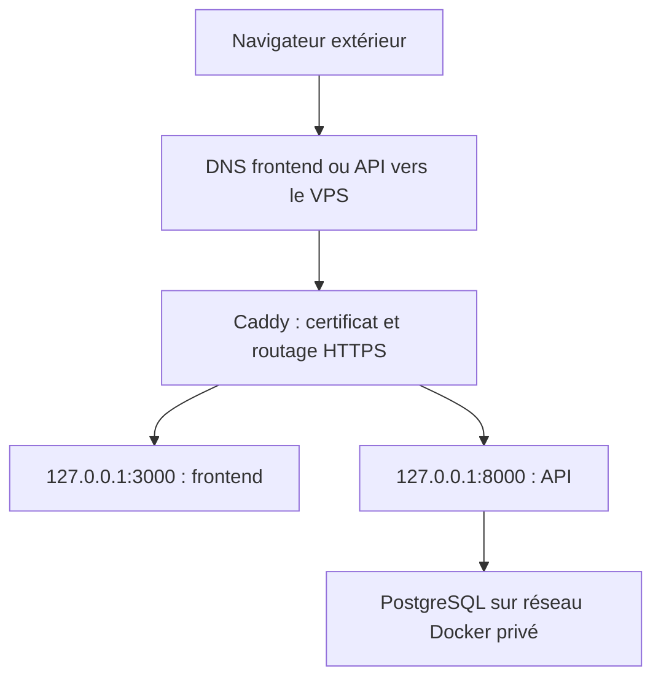

# VPS — Caddy : du bootstrap HTTP au proxy HTTPS

**Caddy est installé et sert le VPS. INT-131 est terminée.**
Ce guide explique le proxy. Pour la stack et l'admin déjà créés, lire le
[parcours Tervo](05-tervo-release-et-exploitation.md). Le 19 octobre 2026,
INT-111 active HTTPS : certificats Let's Encrypt, redirections et GET publics
vérifiés. Les commandes et sorties sont dans le
[journal INT-111](../../sprint7.6/INT-111-deploiement-vps.md#9-dns-direct-et-activation-https--19-octobre-2026).
La recette navigateur de bout en bout est ensuite confirmée par l'opérateur.

## 1. Où nous en sommes

| Élément | État vérifié |
|---|---|
| Caddy v2.11.7 | Service natif systemd, actif et activé au démarrage |
| HTTP public | Port 80, redirection 308 vers HTTPS depuis INT-111 |
| Administration Caddy | `127.0.0.1:2019`, pas d'écoute publique |
| 1Panel | Désinstallé : dossiers, anciennes unités et binaires absents |
| OpenResty | Conteneur et image supprimés |
| SSH / Docker / UFW | Actifs ; règles du pare-feu inchangées |
| Dockge | Privé sur 127.0.0.1:5001 ; gate Tervo ensuite validé dans la recette INT-129, pas de mise en service publique |
| Application / PostgreSQL Tervo | Release INT-111 réussie en loopback ; admin créé selon l'opérateur |
| HTTPS Tervo | TCP 443, certificats Let's Encrypt des deux noms, GET frontend/API 200 ; recette navigateur confirmée par l'opérateur |

L'ancien bootstrap affichait une **page de contrôle**, pas l'application Tervo.
Il est désormais remplacé par les proxies HTTPS frontend/API.
La recette INT-129 utilisait des ports loopback distincts ;
son [journal et ses cours](../../sprint7.6/INT-129/README.md) décrivent la suite
sans attribuer à INT-131 ces nouvelles preuves.
Le port TCP 443 écoute depuis l'activation INT-111. Aucun port UDP 443
n'était ouvert dans les règles relevées ; HTTPS reste configuré en h1/h2.
Les contrôles extérieurs ont été faits en IPv4 ; aucune adresse IPv6 globale
n'a été relevée.

## 2. Pourquoi ce choix

Caddy s'occupe uniquement du proxy HTTP/HTTPS, sous systemd.
Les applications tournent dans Docker Compose. Dockge est une console
Compose privée accessible par tunnel SSH, pas un panneau public.

1Panel/OpenResty ont d'abord été conservés pour tester le retour arrière,
puis retirés avec confirmation. La sauvegarde privée reste conservée.

### Lire le trajet publié



Le navigateur appelle l'API publique ; le frontend statique ne devient pas
un serveur SQL. Caddy termine TLS et relaie en HTTP local : aucun certificat
n'est requis dans les conteneurs. Dockge et l'API admin Caddy ne figurent
pas dans le trajet public.

## 3. Ce qui est déjà validé

- Binaire officiel vérifié et installation native.
- Sauvegarde privée de l'ancien panneau/proxy sur le VPS.
- Passage temporaire sur Caddy puis retour à OpenResty/1Panel testé.
- Bascule finale sur Caddy confirmée, avec démarrage automatique activé.
- Marqueur HTTP public vérifié avant et après confirmation.
- Pas d'écoute 7410, 443 TCP/UDP ; administration Caddy locale uniquement.
- Validation et reload du bootstrap vérifiés : même PID, service actif/activé et réponse HTTP conservée.
- Reboot vérifié : Caddy revient seul, anciens services arrêtés ; HTTP public IPv4 et ports d'administration revérifiés.
- Conteneur et dossiers 1Panel supprimés avec confirmation ; Caddy/Docker et réponse HTTP préservés.
- Nettoyage final : image OpenResty supprimée, unités 1Panel absentes et aucun ancien binaire trouvé.
- État privé sans certificat ; journal Caddy fourni sans tentative ACME, HTTPS automatique désactivé.
- Aucun seed ni transfert/suppression de données applicatives Tervo.

Les scripts/tests temporaires de préparation ont été retirés du dépôt.
L'exploitation utilise les commandes standard ci-dessous ; les résultats
déjà obtenus restent enregistrés dans le suivi du sprint.

## 4. Commandes utiles

À exécuter **sur le VPS**, uniquement pour vérifier. Ces commandes sont un
mode d'emploi ; elles n'ont pas été rejouées pour cette révision documentaire :

```bash
sudo systemctl status caddy --no-pager
sudo journalctl -u caddy -b -n 50 --no-pager
curl --noproxy "*" --fail --silent --show-error --max-time 10 https://tervoapp.com/login -o /dev/null -w 'HTTP %{http_code}\n'
```

| Commande | Succès attendu | En cas d'écart |
|---|---|---|
| `systemctl status` | `active (running)`, code 0 | Lire les logs ; ne pas réinstaller le proxy |
| `journalctl -b -n 50` | Jusqu'à 50 entrées du boot actuel, code 0 | Lire les erreurs ; absence de logs ≠ absence de problème |
| `curl` HTTPS | `HTTP 200`, code 0 sans `-k` | Vérifier DNS, service/config active et TLS ; ce n'est pas la recette navigateur |

Après un changement **autorisé** de configuration, valider avant de recharger
(exemple non exécuté ici ; conserver auparavant une copie du fichier actif) :

```bash
sudo /usr/local/bin/caddy validate --config /etc/caddy/Caddyfile --adapter caddyfile \
  && sudo systemctl reload caddy
```

`validate` doit terminer sans erreur (code 0) ; `&&` empêche le reload s'il
échoue. Un reload réussi est normalement silencieux, code 0 : contrôler ensuite
le service et HTTP. **Validation syntaxique ≠ certificat délivré.** Le reload
d'un profil avec vrais domaines peut déclencher ACME ; ne pas le lancer avant
le feu vert de publication et les vérifications DNS.

| Fichier | Rôle |
|---|---|
| `/etc/caddy/Caddyfile` | Configuration active HTTPS frontend/API depuis INT-111 |
| `/etc/systemd/system/caddy.service` | Service natif Caddy |
| `/var/lib/caddy` | État persistant de Caddy |
| `deploy/caddy/production.Caddyfile.example` | Source copiée vers la configuration active lors d'INT-111 ; le fichier du dépôt n'est pas un import dynamique |

Un message de maintenance `tls` n'est pas, à lui seul, une demande de
certificat. Caddy crée aussi des métadonnées de nettoyage en HTTP seul.

## 5. Bascule effectuée et suite

1. Application en loopback et bootstrap admin : faits dans INT-111.
2. DNS des deux noms vers `151.241.228.152`, sans AAAA : vérifié.
3. Bootstrap sauvegardé dans `/root/tervo-caddy-http.MUcPcg/Caddyfile`,
   profil validé, copié puis chargé par reload (voir le journal INT-111).
   Il route frontend/API vers `3000`/`8000`, garde l'admin locale et limite
   HTTPS à HTTP/1.1 et HTTP/2 (pas d'ouverture UDP pour HTTP/3).
4. Certificats et redirections : vérifiés depuis l'extérieur. Recette
   navigateur confirmée par l'opérateur. Préserver `/var/lib/caddy` ; son état
   a été capturé, stocké hors VPS et récupéré intègre (INT-111, section 20).

La réception des emails via Cloudflare est indépendante : **ne pas supprimer
les MX/TXT** en changeant les enregistrements web. L'ancien bootstrap contenait
`auto_https off` ; la configuration active ne contient plus cette option.
La mise en service a ensuite été clôturée par INT-111 : recette navigateur,
reboot réel, sauvegarde/restauration et nettoyage ciblé consignés dans le
[journal INT-111](../../sprint7.6/INT-111-deploiement-vps.md). Ces GET seuls ne
prouvaient pas la mise en service.
Le warning de journal tronqué reste à diagnostiquer séparément : ne pas
supprimer les journaux pour le masquer.

## 6. Sauvegarde et ancien retour arrière

La sauvegarde ancienne reste privée sous `/root/tervo-backups/`.
**Ne plus lancer l'ancien script de rollback vers 1Panel/OpenResty :**
les composants nécessaires ont été supprimés. Un retour à cet ancien état
demanderait une reconstruction depuis la sauvegarde, pas un simple redémarrage.
Le nettoyage des fichiers temporaires sur le VPS est distinct de cette sauvegarde
et ne doit pas toucher au binaire, à l'unité ou à l'état persistant de Caddy.
Les copies de préparation INT-131 et l'archive/installateur 1Panel dans
`/home/tervo` ont été supprimés ; Caddy/Docker et HTTP ont été revérifiés.
Les six dossiers temporaires INT-131 sous `/root` ont aussi été retirés.
Sauvegardes métier/configuration et sauvegarde APT conservées.
L'ancien point sur `1panel-kvm` relève de l'inventaire historique ; ne pas
réexécuter un nettoyage à partir de cette note sans inventaire actuel.

Suivi : [INT-131 dans le sprint 7.6](../../../../docs/stages/stage7/sprint7.6/tasks.md).
