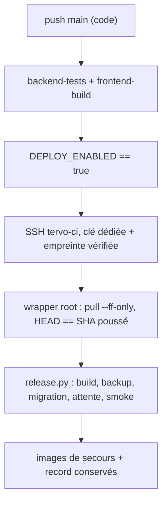

# INT-130 — CI/CD de production sécurisée

**Livrée le 24 octobre 2026.** Premier déploiement CI observé : run push
`40083288592` (tentative 2, même SHA après activation), commit `fd3a42c…`,
release `fd3a42c87e37-6cc4ef39fc49`, migrations avant HTTP et smoke réussis.
L'installation VPS, les secrets et `DEPLOY_ENABLED=true` sont en place. Un
**nouveau** push de code doit encore exercer le déclenchement automatique : la
première tentative du run avait été lancée avant l'activation, puis rejouée.

Point de départ : [INT-111](INT-111-deploiement-vps.md) a validé la mise en
service manuelle et [INT-129](INT-129-release-rollback.md) la commande de
release. INT-130 ne crée pas de second déploiement : le job appelle
`deploy/scripts/release.py` sur le VPS, avec une identité dédiée.

## 1. Ce qui est livré dans le dépôt

| Livrable | Rôle |
|---|---|
| `.github/workflows/ci.yml` — job `deploy` | Après tests backend et build frontend, pousse le SHA vers l'identité CI |
| `deploy/scripts/ci-release.sh` | Wrapper privilégié installé sous `/usr/local/sbin/tervo-ci-release` |
| `environment: production` | Portée des secrets et futur point d'ajout d'une revue obligatoire |
| Variable `DEPLOY_ENABLED` | Interrupteur : absent ou ≠ `true` → job ignoré, CI de vérification inchangée |

Le job ne construit aucune image : le VPS construit, migre, démarre, teste et
conserve les images de secours via `release.py`. Aucun `docker prune`.
Avant l'appel, le wrapper aligne `TERVO_IMAGE_TAG` et `TERVO_VCS_REF` dans
`deploy/.env` sur le SHA demandé (deux lignes seulement, mode et propriétaire
conservés), car `release.py` refuse un env qui ne correspond pas au commit.



## 2. Identité et frontière de privilèges

| Objet | Valeur | Justification |
|---|---|---|
| Compte SSH | `tervo-ci`, sans groupe Docker | Ne peut pas administrer Docker directement |
| Clé | dédiée à la CI, distincte de la clé personnelle | Révocation indépendante ; empreinte publique `SHA256:F5PsB6dzeuOCtMaOrDQ4egc93WI0NYypSQmqG469lSE` |
| `authorized_keys` | `restrict,command="sudo -n /usr/local/sbin/tervo-ci-release"` | La clé ne donne aucun shell, aucune redirection |
| sudoers | une seule ligne, commande exacte sans argument | Pas de `NOPASSWD: ALL` |
| Wrapper | `root:root`, `0755`, non modifiable par `tervo-ci` | Seul point d'entrée privilégié |
| SHA attendu | lu sur stdin, `^[0-9a-f]{40}$` | Aucun wildcard d'arguments sudoers |

Conséquence assumée : une clé CI compromise peut déclencher une release d'un
commit qui est **HEAD de `main` avec un checkout propre**, mais ne peut ni lire
les secrets, ni exécuter une autre commande, ni choisir les chemins ou les
options de release. Le compte reste root-equivalent *à travers ce wrapper* ;
c'est la limite de Docker Compose, pas un RBAC.

Le wrapper répète les contrôles de `release.py` (checkout propre, `HEAD == SHA`)
car il effectue le `git pull --ff-only origin main` avant la release. Le
checkout VPS peut être sur `main` attaché ou détaché au SHA publié : le pull
avance `HEAD` en fast-forward sans déplacer de branche. Il relâche le verrou
avant `release.py`, qui le reprend : en cas de concurrence, la release de la CI
échoue proprement au lieu de modifier le checkout pendant une release opérateur.

## 3. Préparation du VPS — root

À exécuter **une fois** depuis le terminal root de l'opérateur. Les valeurs
`<PUBLIC_KEY>` et `<CONTENU DE deploy/scripts/ci-release.sh>` sont remplacées ;
aucune clé privée n'est écrite ici.
Le wrapper est copié depuis le bloc fourni, puis mis à jour uniquement par
l'opérateur lorsqu'il change dans le dépôt.

Avant d'installer, contrôler le checkout en lecture seule :

```sh
git -C /opt/stacks/tervo status --porcelain   # attendu : silence
git -C /opt/stacks/tervo rev-parse HEAD      # SHA actuellement présent
git -C /opt/stacks/tervo log -1 --oneline    # contrôle lisible
```

Un checkout modifié arrête la procédure. La branche `main` attachée n'est pas
requise : le 24 octobre 2026, le checkout de production était détaché à
`291f7ea` et propre ; le wrapper le fait avancer par
`git pull --ff-only origin main`.

```sh
(
  set -eu
  test "$(hostname)" = 22565
  test "$(id -u)" = 0

  id tervo-ci >/dev/null 2>&1 || useradd --create-home --user-group --shell /bin/sh tervo-ci
  install -d -o tervo-ci -g tervo-ci -m 700 /home/tervo-ci/.ssh
  cat > /home/tervo-ci/.ssh/authorized_keys <<'KEY'
restrict,command="sudo -n /usr/local/sbin/tervo-ci-release" ssh-ed25519 <PUBLIC_KEY> tervo-ci-deploy
KEY
  chown tervo-ci:tervo-ci /home/tervo-ci/.ssh/authorized_keys
  chmod 600 /home/tervo-ci/.ssh/authorized_keys

  if [ -f /opt/stacks/tervo/deploy/scripts/ci-release.sh ]; then
    install -o root -g root -m 755 /opt/stacks/tervo/deploy/scripts/ci-release.sh \
      /usr/local/sbin/tervo-ci-release
  else
    cat > /usr/local/sbin/tervo-ci-release <<'WRAPPER'
<CONTENU DE deploy/scripts/ci-release.sh>
WRAPPER
    chown root:root /usr/local/sbin/tervo-ci-release
    chmod 755 /usr/local/sbin/tervo-ci-release
  fi
  sh -n /usr/local/sbin/tervo-ci-release
  cat > /etc/sudoers.d/tervo-ci <<'SUDO'
tervo-ci ALL=(root) NOPASSWD: /usr/local/sbin/tervo-ci-release
SUDO
  chmod 440 /etc/sudoers.d/tervo-ci
  visudo -c

  ssh-keygen -lf /etc/ssh/ssh_host_ed25519_key.pub
)
```

Attendu, code 0 : `visudo` affiche `parsed OK` ; `ssh-keygen -lf` affiche
l'empreinte Ed25519 du serveur. La valeur observée depuis mini-s1 le 24 octobre
2026 est `SHA256:vQCE5tIGPYE11dl6jfRoyS1gMLKxUU1rkkxsKECMZew` ; cette commande
doit la confirmer sur le VPS avant de la configurer dans GitHub.

Pour la **première** installation, le fichier n'existe pas encore sur le VPS
si le commit INT-130 n'a pas été poussé : copier le contenu versionné
`deploy/scripts/ci-release.sh` (bloc fourni avec la demande d'exécution) vers
`/usr/local/sbin/tervo-ci-release`. Après ce premier push, toute modification
du wrapper se réinstalle depuis le checkout root à jour, jamais depuis la CI.

Contrôle négatif à exécuter en root, sans lancer de release :

```sh
su -s /bin/sh tervo-ci -c 'printf "x\n" | sudo -n /usr/local/sbin/tervo-ci-release'
```

Attendu : `Invalid revision.`, code 2 — preuve que la clé/sudoers autorisent
le wrapper et que le SHA est rejeté avant toute opération Git ou Docker.

## 4. Configuration GitHub

Créer l'environnement `production` puis ses secrets et variables. Les valeurs
secrètes ne sont jamais affichées : `gh secret set` lit le fichier.

```sh
gh api --method PUT repos/libileh91/tervo/environments/production >/dev/null

# Variables non secrètes : au niveau dépôt, car le `if:` du job est évalué
# avant l'application de l'environnement (DEPLOY_ENABLED doit y être lisible).
gh variable set DEPLOY_HOST --body 151.241.228.152
gh variable set DEPLOY_USER --body tervo-ci
gh variable set DEPLOY_HOST_FINGERPRINT \
  --body 'SHA256:vQCE5tIGPYE11dl6jfRoyS1gMLKxUU1rkkxsKECMZew'
gh variable set DEPLOY_ENABLED --body false

# Secrets portés par l'environnement production.
gh secret set DEPLOY_SSH_KEY --env production < <fichier_clé_privée>
gh secret set DEPLOY_KNOWN_HOSTS --env production < <fichier_known_hosts>
```

`DEPLOY_KNOWN_HOSTS` contient **une seule ligne** :
`151.241.228.152 ssh-ed25519 <clé publique de l'hôte>`. Le job refuse zéro ou
plusieurs lignes et compare l'empreinte SHA256 à `DEPLOY_HOST_FINGERPRINT`.
Cette empreinte doit être confirmée par la sortie `ssh-keygen -lf` de la section
précédente, pas par la première connexion de la CI.

Le fichier de clé privée est temporaire, `600`, supprimé après l'import ; la clé
publique correspondante est celle autorisée sur le VPS. Ne jamais coller la clé
privée dans ce document, un ticket ou la conversation.

## 5. Activation et preuve attendue

L'activation est le dernier geste, uniquement après la recette manuelle INT-111
et le déploiement du wrapper. Elle a été effectuée le 24 octobre 2026 ; le
premier déploiement a été obtenu en rejouant le run push déjà créé (section 6).
Pour une prochaine activation :

```sh
gh variable set DEPLOY_ENABLED --body true
```

Pousser ensuite un commit de **code** sur `main` (un commit purement
`docs/`, `notes/` ou `*.md` ne déclenche pas le workflow). Observer :

1. `backend-tests` et `frontend-build` verts ;
2. job `Deploy — release VPS` démarré, empreinte vérifiée ;
3. sortie distante `STEP:` puis `PASS: release <id>` et code 0 ;
4. `gh run view <id>` vert, SHA déployé égal au SHA poussé ;
5. `https://tervoapp.com/login` et `https://api.tervoapp.com/health/ready`
   à 200, `/var/lib/tervo/state/current.json` mis à jour.

Échec : le job est rouge, `release.py` renvoie 1 et restaure l'ancienne release
si elle existe ; désactiver immédiatement par
`gh variable set DEPLOY_ENABLED --body false`. Ne pas relancer
en boucle : lire la sortie de l'étape et le journal de release. `deploy/.env`
reste aligné sur le SHA tenté : avant une release manuelle, remettre
`TERVO_IMAGE_TAG`/`TERVO_VCS_REF` sur la release réellement active
(`/var/lib/tervo/state/current.json`).

## 6. Preuves observées le 24 octobre 2026

**Installation VPS** (bloc root opérateur) : checkout avancé de `291f7ea` à
`fd3a42c` par fast-forward, `/etc/sudoers.d/tervo-ci` et `/etc/sudoers`
`parsed OK`, empreinte Ed25519 `SHA256:vQCE5tIGPYE11dl6jfRoyS1gMLKxUU1rkkxsKECMZew`
confirmée sur le serveur, contrôle négatif `Invalid revision.` code 2 sans
release ni accès Git/Docker.

**Run GitHub [40083288592](https://github.com/libileh91/tervo/actions/runs/40083288592),
tentative 2** (même événement `push`, même SHA `fd3a42c…`) :

- `backend-tests` et `frontend-build` verts ; `Deploy — release VPS` vert en
  1 min 10 s ;
- `Empreinte SSH vérifiée` avant la connexion ;
- sortie distante : `Already up to date.` puis `STEP:` validation env/Compose,
  gel Dockge, build, `STEP: migrate, grant and check before starting HTTP`,
  smoke ; `PASS: backend readiness, frontend health and login page` ;
- `PASS: release fd3a42c87e37-6cc4ef39fc49`.

**VPS, lecture seule opérateur après la release** :

```text
current.json : {"release_id": "fd3a42c87e37-6cc4ef39fc49"}
tervo-backend-1  Up 23 minutes (healthy)  127.0.0.1:8000->8000/tcp
tervo-frontend-1 Up 23 minutes (healthy)  80/tcp, 127.0.0.1:3000->3000/tcp
tervo-postgres-1 Up 11 hours   (healthy)  5432/tcp
revision=fd3a42c87e3798b2d6f3cdd7d791fdcb6ceb252b (backend et frontend)
dockge-dockge-1 running=true ; Caddy active
8000/3000/5001 en 127.0.0.1 ; aucune écoute hôte sur 5432
```

Les conteneurs HTTP sont créés depuis la configuration de secours de
`release.py` : `.Config.Image` affiche l'ID exact (`sha256:339a3e…` /
`sha256:e84a71…`) et le label `org.opencontainers.image.revision` porte le SHA
déployé. PostgreSQL n'a pas été recréé (11 h de fonctionnement).

**Agent, depuis mini-s1 après la release** : `https://tervoapp.com/login` 200,
`https://api.tervoapp.com/health/ready` 200, `http://tervoapp.com/login` 308,
TLS `0`.

**Limite de cette preuve** : le déclenchement automatique d'un **nouveau** push
n'a pas encore été observé ; la tentative 2 rejoue le push de `fd3a42c` après
activation. Le prochain commit de code l'exercera ; un commit uniquement
`docs/`, `notes/` ou `*.md` est ignoré par `paths-ignore`.

## 7. Limites explicites

- L'environnement `production` n'a **pas** de revue obligatoire dans cette
  version : `DEPLOY_ENABLED` est le seul frein, et un push de code déploie.
  Ajouter un reviewer à l'environnement est la protection suivante, non activée.
- Le wrapper reproduit l'engagement `--maintenance-confirmed` : il n'affiche
  pas de page de maintenance et ne met pas Caddy en pause. Une release coupe
  brièvement le HTTP applicatif ; les autres writers SQL/Docker doivent être
  absents (verrou et gel Dockge contrôlés par `release.py`).
- Le compte CI traverse un point root-equivalent borné ; ce n'est pas un RBAC.
- Le wrapper installé ne se met pas à jour tout seul : une modification du
  fichier versionné exige une réinstallation root avant de compter dessus.
- Aucune image n'est publiée dans un registry (`GHCR` hors périmètre) ; les
  images de secours restent sur le VPS.
- Les pushes purement documentaires sont ignorés ; un déploiement n'est pas
  déclenché par une note.
- Aucun monitoring automatique d'un déploiement ni de la production n'est
  ajouté ; la preuve reste le run GitHub et les GET manuels.

## 8. Dépannage

| Symptôme | Cause probable | Réaction |
|---|---|---|
| `Permission denied (publickey)` | Clé CI absente/retirée, ou mauvais compte | Vérifier `authorized_keys`, ne pas élargir sudo |
| `Host key verification failed` | `DEPLOY_KNOWN_HOSTS` ne correspond pas à l'hôte | Relever l'empreinte sur le VPS, corriger le secret |
| Job `Deploy` absent | `DEPLOY_ENABLED` ≠ `true`, push non-`main`, ou run sauté (docs) | Vérifier la variable et les fichiers poussés |
| `fatal: HEAD does not point to a branch` | Ancien wrapper exigeant une branche attachée | Corrigé dans `fd3a42c` : pull `origin main` sur checkout attaché ou détaché |
| `Server HEAD does not match` | Un autre commit est sur `main` | Relancer après le bon SHA, ne pas forcer le serveur |
| `Another release operation holds the lock` | Release opérateur en cours | Attendre la fin, ne pas supprimer le verrou |
| `Release failed: ...` | Migration/smoke/permissions | Lire la sortie, garder les images de secours, ne pas improviser de restore |

Cas de test : TC-INT-111-06, propriétaire INT-130.
